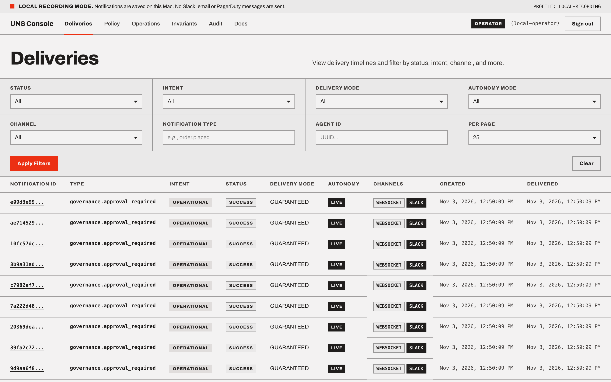
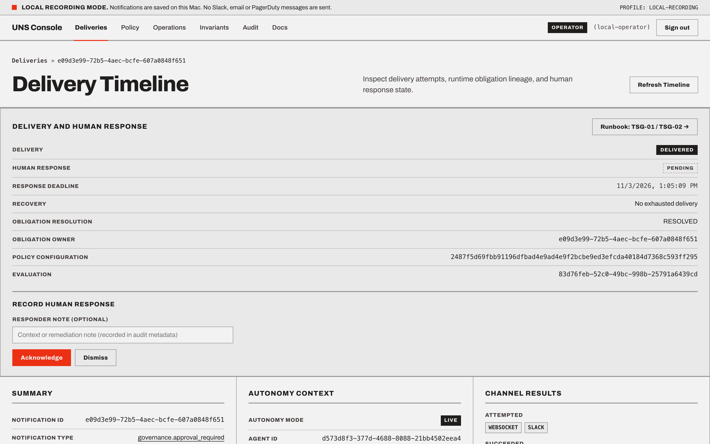
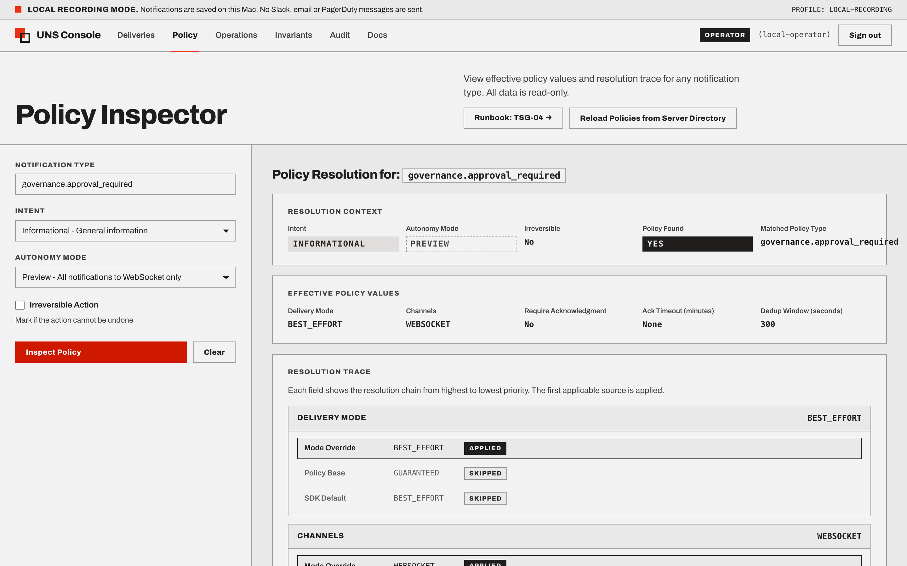
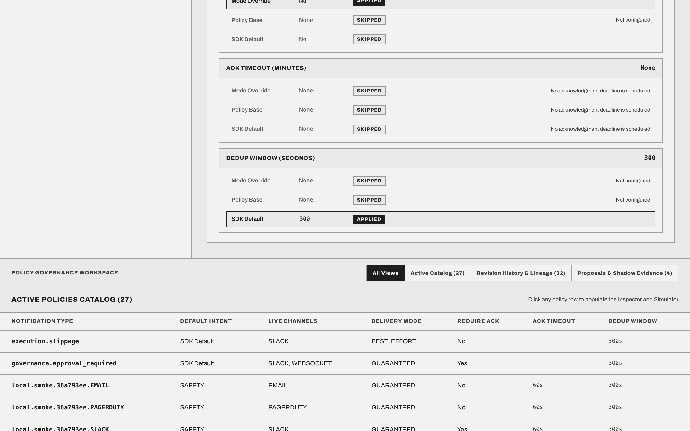
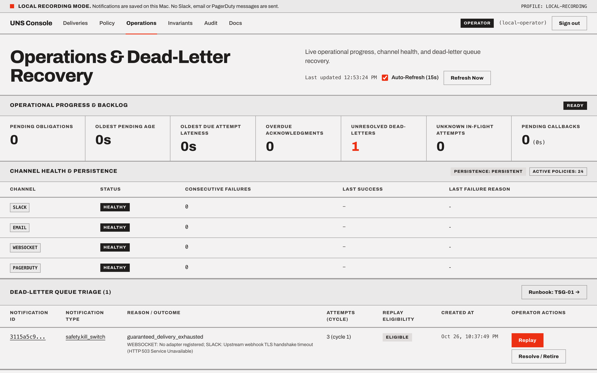
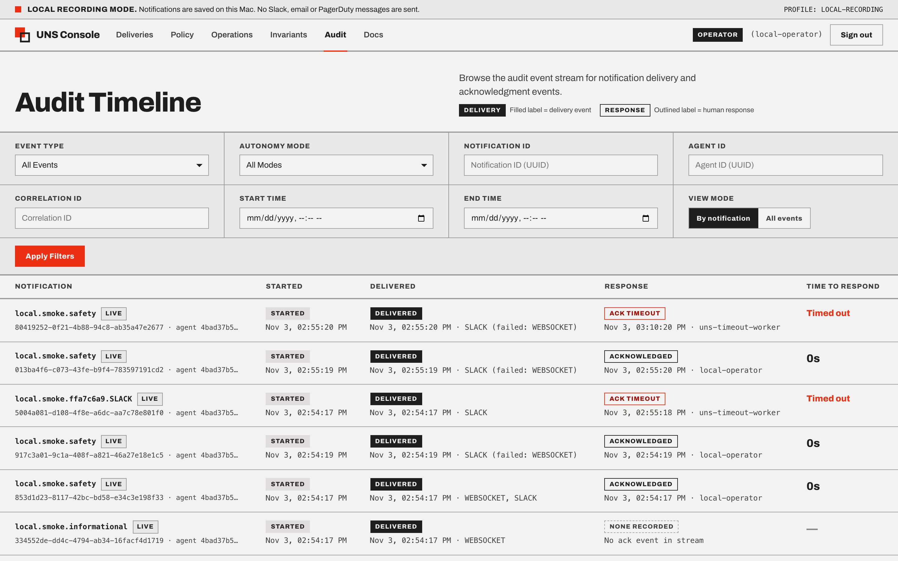
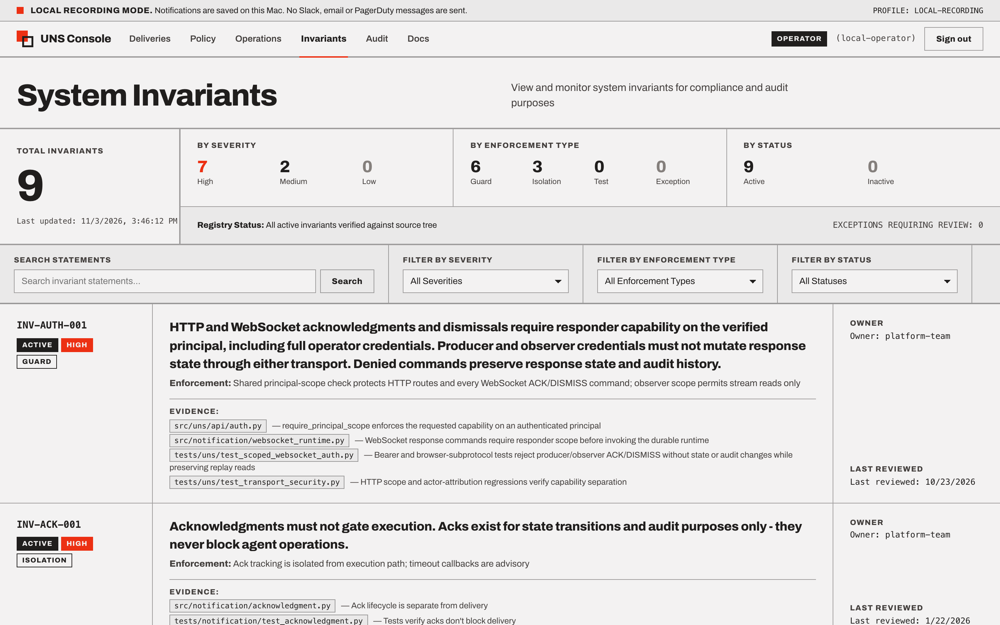
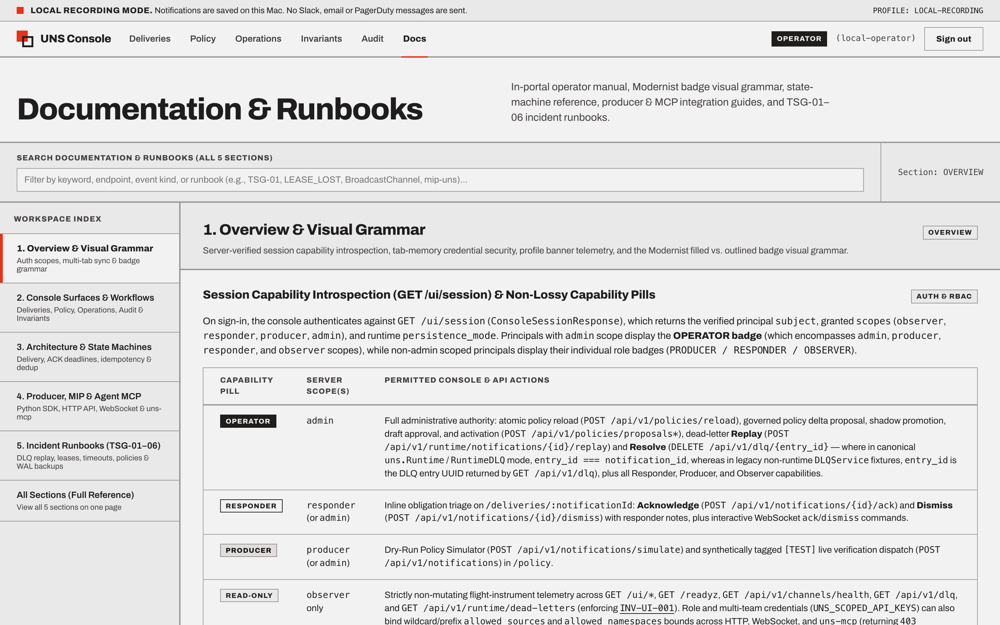

# UNS, Unified Notification Service

<picture>
  <source media="(prefers-color-scheme: dark)" srcset="https://raw.githubusercontent.com/ylecoyote/uns/main/docs/assets/logo/uns-lockup-dark.svg" />
  <source media="(prefers-color-scheme: light)" srcset="https://raw.githubusercontent.com/ylecoyote/uns/main/docs/assets/logo/uns-lockup.svg" />
  
</picture>


**Durable human-response obligations, immutable policy provenance, and bounded pre-execution governance for autonomous agents and high-trust backend workflows.**

When autonomous agents, MCP tools, or background workflows emit operational signals or request high-stakes actions, ordinary fire-and-forget webhooks leave operators guessing: *Which policy revision governed this signal? Did an untrusted producer payload try to weaken its routing floor? Did a provider accept it? Was it coalesced with an earlier incident? Did an authorized responder actually acknowledge it before the deadline?*

UNS treats an important notification as a **recoverable human-response obligation** backed by a transactional SQLite or PostgreSQL outbox (`uns.Runtime`). Policy resolution, acceptance, deduplication ownership, and audit provenance commit together at intake so accepted work retains the exact policy revision that governed it, even across process restarts, provider timeouts, or later policy updates. Teams can adopt `uns.Runtime` and `uns.Client` first as a standalone obligation-tracking and escalation layer, and optionally wire in `uns.governance` when a host runtime wants pre-execution action decisions bound to those obligations.

| Lifecycle Event | What UNS Establishes |
| :--- | :--- |
| **Accepted (`PENDING`)** | The service has committed recoverable outbox work bound to an immutable policy revision hash. |
| **Delivered (`DELIVERED`)** | A qualifying persistent channel (`SLACK`, `EMAIL`, `PAGERDUTY`) returned a confirmed delivery result. |
| **Coalesced (`DEDUPLICATED`)** | The event was linked to an active canonical obligation (`obligation_owner_id`) and inherits its response tracking (`effective_ack_status`, `ack_inherited`). |
| **Responded (`ACKED` / `DISMISSED`)** | An authenticated principal recorded a terminal response before the deadline elapsed. |
| **Timed Out (`TIMED_OUT`)** | No response was recorded before the deadline; a durable terminal event is emitted for downstream escalation callbacks. |

## Core Capabilities & Boundaries

- **Agent-Native Intake & Policy-Floor Enforcement:** `SendNotificationRequest` binds `autonomy_context` (`LIVE`, `SHADOW`, `PREVIEW`, `agent_id`, optional `plan_id`, `decision_snapshot_id`, `execution_snapshot_id`, `skip_snapshot_id`), `intent` (`SAFETY`, `GOVERNANCE`, `OPERATIONAL`, `INFORMATIONAL`), and `irreversible: bool`. Producer payloads cannot weaken an `ACTIVE` policy's delivery mode, channels, acknowledgment requirement, priority, or timeout (`422`), and caller-supplied routing overrides (`slack_channel`, `email_to`, `pagerduty_routing_key`) are rejected at intake so a misconfigured or prompt-injected upstream agent cannot downgrade a `SAFETY` alert or reroute an obligation.
- **Scoped Credential & Multi-Team Namespace Isolation:** Supports least-privilege API keys (`UNS_PRODUCER_API_KEY`, `UNS_RESPONDER_API_KEY`, `UNS_OBSERVER_API_KEY`) and multi-team JSON credentials (`UNS_SCOPED_API_KEYS`) alongside the full operator key (`UNS_API_KEY`), with fail-closed `allowed_sources` (`ci-*`, `agent-*`) and `allowed_namespaces` (`deploy.*`, `security.*`) isolation across HTTP REST, Console (`/ui/*`), WebSocket streams, and `uns-mcp`.
- **Simulation-First MCP (`uns-mcp`):** Defaults to read-only stdio, provides dry-run `simulate_signal`, and requires explicit `--enable-writes`, `operator_intent="deliver"`, and `UNS_MCP_DELIVERY_CONFIRMATION_TOKEN` before emitting real external signals.
- **Bi-Directional Signed Provider Sync & Failure-Aware Deduplication:** Inbound HMAC-SHA256 signed Slack Block Kit interactivity (`POST /api/v1/webhooks/slack`) and PagerDuty v3 (`POST /api/v1/webhooks/pagerduty`) webhooks resolve follower notifications to their canonical `obligation_owner_id`, update Slack messages in place, and synchronize outbound PagerDuty incidents (`uns-pd-<obligation_owner_id>`). Pending dedup ownership survives TTL expiry and promotes followers or hands off to a successor (`dedup_successor_id`) on failure.
- **Governed Self-Tuning Policies (`PolicyDelta` + Shadow Evaluation):** `producer` credentials can propose `PolicyDelta` adjustments (`promote_to_shadow=false`), while `SHADOW -> DRAFT -> ACTIVE` promotion requires `admin` authority, `BOUNDS`/`CONFLICT`/`INVARIANTS` guard checks, matching `baseline_config_hash`, exact `draft_policy_id`/`draft_content_hash` binding, and inline `ShadowPolicyEvaluator` sample/accuracy gates (`UNS_SHADOW_MIN_SAMPLES`, `UNS_SHADOW_ACCURACY_THRESHOLD`).
- **Host-Integrated Pre-Execution Approval Bridge (`uns.governance`) & Explicit Scope Boundary:** Core notification acknowledgments record human receipt, not action authorization. When a host runtime explicitly gates tool or workflow execution on the opt-in `uns.governance` package (`decide()`, `DecisionEngine`, `GovernanceApprovalBridge`), UNS evaluates deterministic rules (`DENY > REQUIRE_APPROVAL > ALLOW`) with per-intent fail modes, binds `REQUIRE_APPROVAL` decisions to durable `uns.Runtime` obligations with RFC 8785 context-fingerprint verification, and emits HMAC-SHA256 signed resume callbacks (`X-UNS-Signature`, `X-UNS-Timestamp`). `uns.governance` is an in-process evaluator and obligation bridge rather than an external network/IAM sandbox; the calling host remains responsible for consulting `engine.evaluate()` before executing an action. Legacy root-level action-authorization models in `notification.models` remain experimental compatibility types.
- **Delivery Fallback & Tamper-Evident SLO Receipts (`uns-slo-certify`):** `GUARANTEED` mode performs bounded durable retries across selected persistent channels (`Slack → Email → PagerDuty`), surfacing a visible dead-letter entry on exhaustion. `uns-slo-certify` computes deterministic SHA-256 readiness receipts (`receipt_sha256`) across backlog gauges, response latency percentiles (`p50`, `p95`, `max`), and provider error budgets.

## Quickstart & Python Example

```python
from uuid import uuid4
from uns import Client, Runtime
from uns.governance import DecisionEngine, GovernanceApprovalBridge, load_policy_from_yaml
from uns.responses import SendNotificationRequest

runtime = Runtime("sqlite:///uns.db", create_tables=True)
client = Client(runtime, principal="agent-supervisor")

# 1. Durable notification obligation with agent autonomy provenance
result = await client.send(
    SendNotificationRequest(
        notification_type="deploy.production",
        intent="GOVERNANCE",
        title="Approve production rollout v2.4.0",
        message="Canary error rate is 0.01% over 30m window; awaiting operator sign-off.",
        source="release-agent",
        irreversible=True,
        autonomy_context={"agent_id": str(uuid4()), "autonomy_mode": "LIVE", "plan_id": str(uuid4())},
        idempotency_key="deploy-v2.4.0-prod",
    )
)

# 2. Optional: host-integrated pre-execution gate bound to a durable UNS approval obligation
bridge = GovernanceApprovalBridge(runtime=runtime, callback_secret="hmac-resume-secret")
engine = DecisionEngine(policy=load_policy_from_yaml(policy_yaml), approval_bridge=bridge)
outcome = await engine.evaluate(
    context={"environment": "prod", "blast_radius": "high"},
    principal_id="release-agent",
    action="k8s.rollout.promote",
    intent="GOVERNANCE",
    tenant_id="platform",
    resource_type="deployment",
    resource_id="payments-api",
)
# outcome.record.decision == Decision.REQUIRE_APPROVAL -> backed by runtime obligation
```

From this repository, with Python 3.12:

```sh
python3 -m venv .venv
.venv/bin/pip install -e '.[dev]'
.venv/bin/python examples/uns_demo.py
.venv/bin/python examples/mip_producer_demo.py
```

The demos use a local recording adapter, accept and deliver signals, exercise dry-run simulation, deduplication coalescing, and operator acknowledgment, and verify audit history without sending external network traffic. Starting the persistent HTTP daemon (`uns`) requires an explicit `UNS_DATABASE_URL` (or `--in-memory` for ephemeral testing). See [deployment](docs/DEPLOYMENT.md) for the durable HTTP service, [operator console guide](docs/user-guides/OPERATOR-CONSOLE-GUIDE.md) for the 6-surface Responder & Operator Console (`/deliveries`, `/policy`, `/operations`, `/invariants`, `/audit`, `/docs`), and [API](docs/API.md) for the canonical Python and MCP interfaces.

Simulation has no side effects. Acceptance means recoverable pending work. Delivery requires a channel result. Human acknowledgment is a separate state.

## Responder & Operator Console (`apps/ui`)

The **UNS Console** is a 6-surface React 19 + TypeScript 5.9 application styled in the **Modernist** Swiss-grid design system, pairing filled machine-delivery badges (`DELIVERED`, `FAILED`, `DEDUPLICATED`) with outlined human-obligation badges (`ACKED`, `DISMISSED`, `PENDING`, `TIMED_OUT`).

### 1. Deliveries Explorer & Obligation Triage (`/deliveries` & `/deliveries/:id`)




### 2. Policy Workspace, Proposals & Shadow Evidence (`/policy`)




### 3. Operations, Dead-Letter Recovery, Audit Timeline & In-Portal Runbooks (`/operations`, `/audit`, `/invariants`, `/docs`)








## Documentation

- [Product boundary](docs/PRODUCT.md)
- [Roadmap (`v0.2.0` → `v1.0.0`)](docs/ROADMAP.md)
- [Architecture](docs/ARCHITECTURE.md)
- [API](docs/API.md)
- [Delivery semantics](docs/sections/delivery-semantics.md)
- [Policy lifecycle](docs/sections/policy-lifecycle.md)
- [Deployment](docs/DEPLOYMENT.md) and [security](docs/SECURITY-MODEL.md)
- [Testing and acceptance](docs/TESTING.md)
- [Migration and provenance](docs/MIGRATION.md)

`examples/policies/mip-uns` and `config/notification_policies` contain sample policies, not mandatory runtime defaults. Existing `uns`, `notification`, and `uns_mcp` imports remain available. New integrations use `uns.Client` and `uns.Runtime` with the `full` extra. The legacy low-level `NotificationSDK` resolves policy and needs an explicit delivery handler; without one it returns PENDING and attempts no channels.

## Verification & Provenance

The canonical development branch is **main**, containing the consolidation and both remediation iterations. See the [consolidated baseline](docs/CONSOLIDATED_BASELINE.md) for merge provenance and fresh verification.

Adversarial remediation adds durable policy revision checks, explicit dedup ownership, replay cycles, per-provider lease guards, independent callback recovery, authenticated transport reads, and bounded archive/retention tooling. The [second remediation iteration](docs/REMEDIATION_ITERATION2.md) strengthens window/replay ownership, channel-result evidence, SMTP timeout semantics, callback fairness, read-only policy loading and direct MCP reads. See [verification](docs/TESTING.md) for checked behavior and remaining deployment limits.

The [deployment smoke report](docs/DEPLOYMENT_SMOKE.md) records the latest container and live HTTP/WebSocket/MCP/browser checks. It distinguishes the local recording-only rehearsal from a lasting deployment and real-provider acceptance. The selected [localhost recording service](docs/LOCAL_DEPLOYMENT.md) is deployed with persistent storage and a private API key. It is explicitly a recording profile, with no real Slack, email or PagerDuty messages.

Release `v0.6.1` validates hosted GitHub Actions CI across Python 3.11-3.13, `1,973` Python tests, `71` SQLite + PostgreSQL 16 adversarial regression tests (`tests/uns/test_security_and_runtime_remediations.py`), `23` live PostgreSQL 16 operational acceptance and sustained concurrency/load tests (`tests/uns/test_postgres_and_load.py`), the `uns.governance` authorization and approval bridge (`tests/governance/`), and the 6-surface React 19 + TypeScript 5.9 + ESLint 9 UNS Console (`346` UI tests).

Apache License 2.0 - see [LICENSE](LICENSE). Local validation is recorded in docs/TESTING.md; real-channel receipt is a separate opt-in smoke check.
