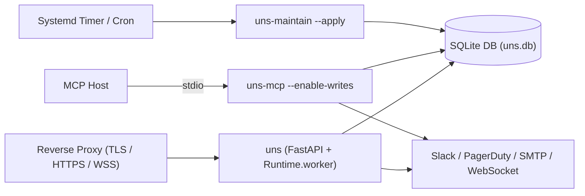

# Deploy UNS

The selected [persistent localhost recording deployment](LOCAL_DEPLOYMENT.md) is running. The [earlier deployment smoke report](DEPLOYMENT_SMOKE.md) preserves container, socket and browser evidence.

This guide covers local and single-node production deployment of the Unified Notification Service (`uns`), including environment configuration, process topology, reverse-proxy/TLS setup, `uns-mcp` lifecycle, migrations, backups, and explicit database retention (`uns-maintain`).

## Supported local profile

The reproducible profile is Python 3.12, a file-backed SQLite database and recording adapters. Supported Python metadata starts at 3.11. PostgreSQL locking and real-provider acceptance remain separate checks. In-memory SQLite requires explicit opt-in for HTTP demos and is always rejected by write-enabled MCP CLI startup.

Install `.[full]` in an isolated environment. The server extra includes Uvicorn standard protocol dependencies, including network WebSocket support. The Dockerfile installs its exact built UNS wheel; the Compose readiness probe authenticates with its configured operator key. For a local service:

```sh
export UNS_DATABASE_URL='sqlite:///./uns.db'
.venv/bin/uns-migrate
export UNS_API_KEY='replace-with-your-local-test-key'
export UNS_API_PRINCIPAL='local-operator'
.venv/bin/uns
```

Use actual deployment secret provisioning rather than committing environment files. Back up an existing database before migration. Only `/health` and `/healthz` are public liveness; readiness accepts authenticated credentials with `observer` scope, while `/metrics` requires the full operator credential. Shared hosting needs HTTPS/WSS and a trusted origin. Do not expose a development server publicly.

### Persistence at HTTP startup

The `uns` CLI and the default HTTP application factory refuse to start with a missing, empty, or in-memory database URL unless ephemeral operation is explicitly enabled. The check also applies when Uvicorn imports `uns.app:app` or `uns.app:app`, including the shipped Docker command and ASGI factory startup. Configure a persistent `UNS_DATABASE_URL` (or its supported alias), migrate it, and mount the database directory on persistent storage when using a container.

For an intentional local demo, use `uns --in-memory` or set `UNS_ALLOW_IN_MEMORY=true` before starting the HTTP service. Missing or empty database configuration then selects `sqlite://`. These options permit volatile storage; they do not replace an already configured persistent URL. `/readyz` reports the actual `persistence_mode` as `persistent` or `in_memory`. The HTTP opt-in does not relax the separate persistent-storage requirement for MCP writes.

Startup validation and runtime diagnostics share the same SQLAlchemy URL parser. SQLite URLs without a file path—including `sqlite://`, `sqlite:///`, and `sqlite+pysqlite://`—and explicit `:memory:` databases are volatile. SQLite file URIs such as `sqlite:///file:memdb1?mode=memory&uri=true` are also volatile. URI options only apply when `uri=true` is enabled; memory-related text inside an ordinary filename or a different database backend does not select in-memory SQLite.

Embedded code can still deliberately construct a memory `Runtime` or call the compatibility `build_runtime()` builder, then pass that runtime explicitly to `create_app(runtime=...)`. That trusted composition does not require the HTTP environment opt-in. Calling `create_app()` without an injected runtime uses the guarded service configuration.

---

## Complete Environment Variable Reference

UNS reads `UNS_*` environment variables first and falls back to `UNS_*` aliases for backward compatibility (`src/uns/config.py` and `src/uns/api/auth.py`).

### Core Runtime & HTTP Server

| Variable | Legacy Alias | Default | Required | Description |
| :--- | :--- | :--- | :--- | :--- |
| `UNS_DATABASE_URL` | `UNS_DATABASE_URL`, `DATABASE_URL` | No implicit service database | **Yes**, except explicit HTTP memory mode | SQLAlchemy database URL (e.g., `sqlite:////var/lib/uns/uns.db`). Use file-backed SQLite for the exercised deployment profile. Write-enabled MCP rejects volatile storage; `uns-maintain` requires a persistent SQLite file. |
| `UNS_ALLOW_IN_MEMORY` | `UNS_ALLOW_IN_MEMORY` | `false` | No | Explicit HTTP demo opt-in (`true`/`1`/`yes`/`on`), also enabled by `uns --in-memory`. Permits missing or volatile database configuration; does not weaken the MCP write guard. |
| `UNS_API_KEY` | `UNS_API_KEY` | *(None)* | For operator access | Full operator credential (`admin`, `producer`, `responder`, `observer`), required for administrative endpoints and `/metrics`. Scoped credentials can access their permitted endpoints without this key. If no credentials are configured, protected endpoints return `503 write_auth_not_configured`. |
| `UNS_API_PRINCIPAL` | `UNS_API_PRINCIPAL` | `uns-api-key` | **Yes** (MCP Writes) | Audited actor/principal identity bound to `UNS_API_KEY` and `uns-mcp --enable-writes`. |
| `UNS_PRODUCER_API_KEY` | `UNS_PRODUCER_API_KEY` | *(None)* | No | Grants `producer` and `observer`: submit/simulate notifications and read status/audit. Cannot acknowledge, dismiss, or administer policies and dead letters. |
| `UNS_PRODUCER_API_PRINCIPAL` | `UNS_PRODUCER_API_PRINCIPAL` | `uns-producer` | No | Audited principal bound to the producer credential. |
| `UNS_RESPONDER_API_KEY` | `UNS_RESPONDER_API_KEY` | *(None)* | No | Grants `responder` and `observer`: ACK/DISMISS through HTTP or WebSocket commands and read status/audit. Cannot submit notifications or administer policies and dead letters. |
| `UNS_RESPONDER_API_PRINCIPAL` | `UNS_RESPONDER_API_PRINCIPAL` | `uns-responder` | No | Audited principal bound to the responder credential. |
| `UNS_OBSERVER_API_KEY` | `UNS_OBSERVER_API_KEY` | *(None)* | No | Grants `observer`: Console, status/audit, readiness, and WebSocket stream/replay reads. Does not permit mutations or `/metrics`. |
| `UNS_OBSERVER_API_PRINCIPAL` | `UNS_OBSERVER_API_PRINCIPAL` | `uns-observer` | No | Principal bound to the observer credential. |
| `UNS_HOST` | `UNS_HOST` | `127.0.0.1` | No | Bind address for the `uns` HTTP/WebSocket server (`--host` CLI override). |
| `UNS_PORT` | `UNS_PORT` | `8000` | No | TCP port for the `uns` HTTP/WebSocket server (`--port` CLI override). |
| `UNS_POLICY_DIR` | `UNS_POLICY_DIR` | *(None)* | No | Directory of YAML policy definitions loaded and persisted into the durable `notification_policies` store at startup. |
| `UNS_CREATE_TABLES` | `UNS_CREATE_TABLES` | `false` (`true` for explicit in-memory operation) | No | When `true`, runs additive table bootstrap on startup (`uns-migrate` is recommended instead in production). |
| `UNS_ALLOWED_ORIGINS` | `UNS_ALLOWED_ORIGINS` | `http://localhost:5173,http://127.0.0.1:5173` | No | Comma-separated list of allowed CORS and WebSocket `Origin` headers for the UNS Console. |
| `UNS_ALLOW_UNAUTHENTICATED_READS` | `UNS_ALLOW_UNAUTHENTICATED_READS` | `false` | No | Compatibility flag (`true`/`1`/`yes`) permitting unauthenticated HTTP `GET`/`HEAD` on read routes only. Never enables writes, `/readyz`, `/metrics`, or WebSockets. |
| `UNS_ENABLE_DOCS` | *(None)* | `false` | No | Enables interactive `/docs`, `/redoc`, and `/openapi.json` endpoints when set to `true`. Keep `false` in production. |

Use distinct secret values for different capability roles; configuring the same secret for multiple roles combines their granted scopes. Capability scopes restrict operations, not tenant or per-producer data access. WebSocket connections require `observer` scope, while each ACK/DISMISS command requires `responder` scope. See the [Security Model](SECURITY-MODEL.md) for the complete authority and attribution contract.

### MCP Process (`uns-mcp`)

| Variable | Legacy Alias | Default | Required | Description |
| :--- | :--- | :--- | :--- | :--- |
| `UNS_MCP_DELIVERY_CONFIRMATION_TOKEN` | `UNS_MCP_DELIVERY_CONFIRMATION_TOKEN` | *(None)* | **Yes** (`--enable-writes`) | Secret token required by `send_signal` (`operator_confirmation_token`) when `deliver=true` in write-enabled MCP mode. |

### Channel Providers

Configure only intended providers/recipients:

- `UNS_SLACK_BOT_TOKEN`, `UNS_SLACK_CHANNEL`.
- `UNS_PAGERDUTY_ROUTING_KEY`.
- `UNS_SMTP_HOST`, `UNS_SMTP_PORT`, `UNS_SMTP_USER`, `UNS_SMTP_PASSWORD`, `UNS_EMAIL_FROM`, `UNS_EMAIL_TO`.

| Variable | Legacy Alias | Default | Description |
| :--- | :--- | :--- | :--- |
| `UNS_SLACK_BOT_TOKEN` | `UNS_SLACK_BOT_TOKEN` | *(None)* | Slack Bot OAuth token (`xoxb-...`). Registers `SlackAdapter` when set. |
| `UNS_SLACK_CHANNEL` | `UNS_SLACK_CHANNEL` | `""` | Default target Slack channel ID or name (e.g., `#ops-alerts`). |
| `UNS_PAGERDUTY_ROUTING_KEY` | `UNS_PAGERDUTY_ROUTING_KEY` | *(None)* | PagerDuty Events API v2 integration/routing key. Registers `PagerDutyAdapter` when set. |
| `UNS_SMTP_HOST` | `UNS_SMTP_HOST` | *(None)* | SMTP server hostname. Registers `EmailAdapter` when set. |
| `UNS_SMTP_PORT` | `UNS_SMTP_PORT` | `587` | SMTP server port (integer). |
| `UNS_SMTP_USER` | `UNS_SMTP_USER` | `""` | SMTP authentication username. |
| `UNS_SMTP_PASSWORD` | `UNS_SMTP_PASSWORD` | `""` | SMTP authentication password. |
| `UNS_EMAIL_FROM` | `UNS_EMAIL_FROM` | `""` | Sender email address for `EmailAdapter`. |
| `UNS_EMAIL_TO` | `UNS_EMAIL_TO` | `""` | Comma-separated list of default recipient email addresses. |

Missing adapters produce explicit failures. Canonical producer metadata cannot redirect adapter recipients or lower severity.

Use `UNS_POLICY_DIR` for an explicit startup YAML snapshot, or the authenticated policy reload endpoint. Successful activation advances the persisted snapshot revision. Every runtime resolves against that durable authority during intake, including cold MCP processes. Already accepted work retains its previous resolved snapshot.

---

## Process Topology & Concurrency Architecture



1. **Unified HTTP Service (`uns`):**
   - Runs `uvicorn uns.app:app`.
   - On startup, FastAPI's `lifespan` starts `runtime.worker()`, which runs three concurrent 1-second loops in an `asyncio.TaskGroup`:
     - `dispatch_loop`: claims `PENDING` leader notifications (`lease_seconds = 60.0`) and dispatches to configured adapters.
     - `timeout_loop`: marks expired `ack_status = "PENDING"` rows (`deadline <= now`) as `TIMED_OUT`.
     - `callback_loop`: delivers pending terminal callbacks (`ACKED`, `DISMISSED`, `TIMED_OUT`) with exponential backoff up to 3 attempts.
2. **MCP process lifecycle (`uns-mcp`):**
   - `uns-mcp` defaults to read-only trusted-local stdio. To enable writes, configure a persistent database and the host environment:
     - `UNS_DATABASE_URL` (or supported legacy database setting).
     - `UNS_API_PRINCIPAL` for attribution.
     - `UNS_MCP_DELIVERY_CONFIRMATION_TOKEN` for explicit tool delivery confirmation.
   - After `uns-migrate`, launch `uns-mcp --enable-writes`. There are no secret command-line arguments. Send tools still require `deliver=true`, `operator_intent=deliver` and the matching confirmation token. The write-enabled MCP lifespan hydrates policies, starts its own recovery/expiry/callback worker, and cancels/joins it on shutdown. SIGTERM and SIGINT cleanup are exercised locally.
   - Do not run the previous accept-only MCP pattern without recovery and assume pending work will complete. Multiple workers coordinate individual jobs through database claims, not an exclusive process-wide file lock.
3. **Storage & File System Permissions:**
   - Place the SQLite database file on a local POSIX filesystem (never NFS/SMB) owned by the `uns` service user with mode `0600` (directory mode `0700`).
   - All processes sharing the SQLite database (`uns`, `uns-mcp`, `uns-maintain`) must run on the same host with read/write access to both the database file and its parent directory (for SQLite journal/WAL files).

---

## Console

From `apps/ui`, use `npm ci` then `npm run dev`. Node must satisfy `^20.19.0 || ^22.12.0 || >=24.0.0`. The development proxy forwards same-origin `/ui/*` to localhost:8000. For production, serve the SPA and route `/ui/*` to the backend on the same trusted origin.

Operators enter an API key at runtime. Use `UNS_OBSERVER_API_KEY` for the read-only Console; other credentials with `observer` scope also work. A full operator key retains administrative authority even when entered into a read-only UI. The key lives in tab memory only; logout or reload removes it. Do not put keys in VITE variables, browser storage or URLs. See [console instructions](../apps/ui/README.md) and the [Operator Console Guide](user-guides/OPERATOR-CONSOLE-GUIDE.md).

### Building the Console for Production

```sh
cd apps/ui
npm ci
npm run build
# Static assets are emitted to apps/ui/dist/
```

---

## Reverse Proxy & TLS Configuration (Nginx Example)

In production, terminate HTTPS/WSS at a reverse proxy, serve the built `apps/ui/dist` static bundle on the same origin, and proxy API, `/ui/*` data routes, probes, and `/ws/agents/*` to `127.0.0.1:8000`:

```nginx
server {
    listen 443 ssl http2;
    server_name uns.internal.example.com;

    ssl_certificate     /etc/ssl/certs/uns.crt;
    ssl_certificate_key /etc/ssl/private/uns.key;

    root /var/www/uns-console/dist;
    index index.html;

    # Backend API, Console JSON read-models, and health/metrics probes
    location ~ ^/(api|v1|ui|health|healthz|ready|readyz|metrics)(/|$) {
        proxy_pass http://127.0.0.1:8000;
        proxy_set_header Host $host;
        proxy_set_header X-Real-IP $remote_addr;
        proxy_set_header X-Forwarded-For $proxy_add_x_forwarded_for;
        proxy_set_header X-Forwarded-Proto $scheme;
    }

    # Authenticated Agent WebSocket stream
    location /ws/agents/ {
        proxy_pass http://127.0.0.1:8000;
        proxy_http_version 1.1;
        proxy_set_header Upgrade $http_upgrade;
        proxy_set_header Connection "upgrade";
        proxy_set_header Host $host;
        proxy_set_header Origin $http_origin;
        proxy_read_timeout 3600s;
    }

    # SPA client-side routing fallback for Console views (/deliveries, /policy, /invariants, /audit)
    location / {
        try_files $uri $uri/ /index.html;
    }
}
```

---

## Process Supervision & Health Probes

### Systemd Service (`uns.service`)

```ini
[Unit]
Description=UNS Unified Notification Service
After=network.target

[Service]
Type=simple
User=uns
Group=uns
WorkingDirectory=/opt/uns
EnvironmentFile=/etc/uns/uns.env
ExecStartPre=/opt/uns/.venv/bin/uns-migrate
ExecStart=/opt/uns/.venv/bin/uns --host 127.0.0.1 --port 8000
Restart=on-failure
RestartSec=5
TimeoutStopSec=30

[Install]
WantedBy=multi-user.target
```

### Liveness vs. Readiness Probe Configuration

- **Liveness Probe (`GET /healthz`):** Public, unauthenticated. Checks that the ASGI event loop is responsive.
  ```sh
  curl -fsS http://127.0.0.1:8000/healthz
  ```
- **Readiness Probe (`GET /readyz`):** Requires authenticated `observer` scope, included in all configured capability roles. Verifies SQLite connectivity (`SELECT 1`), policy store hydration, DLQ depth, and read-model/audit configuration. A dedicated observer key can replace the operator key in the example below.
  ```sh
  curl -fsS -H "Authorization: Bearer $UNS_API_KEY" http://127.0.0.1:8000/readyz
  ```

---

## Migration and recovery

`uns-migrate` performs additive runtime schema migration, new policy-table bootstrap and scheduling-index creation. Repeated and concurrent startup migrations are tested with SQLite. Existing cumulative attempt counts and audit records remain; replay adds a new cycle rather than erasing history. Iteration 2 adds indexed successor links and normalizes old unattempted callback due times from zero to event time. Migration reconstructs recorded promotion links, including missing successor targets, from retained events. Missing targets and cyclic lineage block replay until an operator resolves/reissues the obligation; they are not treated as proof of non-delivery. Old tied replay/promotion clocks cannot erase handoff evidence. The one-time backfill scans retained work and promotion events; budget upgrade time for large stores and stop old writers before upgrading. Earlier erased promotion evidence cannot be reconstructed.

Old ownerless dedup claims cannot suppress new work. Previously suppressed historical records and policy fields already lost by old persistence cannot be reconstructed reliably. Preserve original source policies and use explicit operator reissue/replay when evidence cannot establish delivery.

Rollback requires the previous code and an appropriate database backup. An older runtime cannot safely process new pending owner/follower generations. Do not run old and new binaries against one active database during rollback.

### Online SQLite Backup & Restore

Before running `uns-migrate`, upgrading binaries, or executing bulk retention:

```sh
# Safe online backup using SQLite's backup API
sqlite3 /var/lib/uns/uns.db ".backup '/var/backups/uns/uns-$(date -u +%Y%m%dT%H%M%SZ).db'"
```

### Secret Rotation

To rotate an operator or scoped HTTP API key, or `UNS_MCP_DELIVERY_CONFIRMATION_TOKEN`:
1. Update the secret in your secret manager / `/etc/uns/uns.env`.
2. Restart `uns` and any write-enabled `uns-mcp` processes (`systemctl restart uns`).
3. Update affected HTTP clients, reconnect WebSocket clients, and re-enter the replacement key in affected UNS Console browser tabs.

---

## Explicit retention

There is no automatic purge. `uns-maintain` defaults to dry-run and requires an operator-selected UTC-aware cutoff and minimum idempotency horizon:

```sh
.venv/bin/uns-maintain --database-url "$UNS_DATABASE_URL" \
  --cutoff "$UNS_RETENTION_CUTOFF" \
  --idempotency-seconds "$UNS_IDEMPOTENCY_SECONDS" \
  --batch-size 100
```

No universal retention duration is prescribed. Expiring a notification row also expires its idempotency key, allowing a later request with that key to create a new notification. Choose the horizon accordingly.

Apply requires `--apply --operator <actor>`. Without `--archive`, existing event/audit history stays in the database and a retained receipt preserves removed operational state. This is operational-table pruning, not database-size compaction.

Optional `--archive /absolute/new-file.json` exports an entire eligible settled group, creates a new file exclusively with mode0600, fsyncs the file and parent directory, verifies its SHA256, then prunes the corresponding rows in the same SQLite writer transaction. A no-content database receipt records archive path/hash, ids, counts and operator. Existing files and symlinks are not overwritten. Export or commit failure preserves database state but may leave an archive/partial file; inspect it and choose a new path before retrying.

Pending delivery, unsettled ACK, open dead letters, callback work, live leases, recent activity and retained dedup/follower/successor references are protected. Policy history and retention receipts are not pruned. The command supports SQLite only and requires the current schema.

A batch limits candidate/deletion rows, not bytes, SQL work or elapsed time. Oversized groups remain. Use `--after-id` with the returned `next_after_id` to advance past examined groups; applying a preview reuses that preview's INPUT cursor, not its returned continuation. A null continuation ends that scan pass. Start a new pass to revisit oversized/newly eligible or earlier-inserted records. Apply always recomputes safety; a cursor is not a snapshot or authorization.

Pruning makes pages reusable; no VACUUM or file-size reduction is claimed. Operators remain responsible for archive retention, storage capacity, backups and restore testing. Run maintenance with a suitable live-service impact budget.

---

## Related Documentation

- [Local Deployment Runbook](LOCAL_DEPLOYMENT.md)
- [Deployment Smoke Report](DEPLOYMENT_SMOKE.md)
- [API Reference](API.md)
- [Security Model](SECURITY-MODEL.md)
- [Support State Machine & Schema](support/STATE-MACHINE-AND-SCHEMA.md)
- [Troubleshooting Guides (TSGs)](tsg/README.md)
- [Operator Console Guide](user-guides/OPERATOR-CONSOLE-GUIDE.md)
