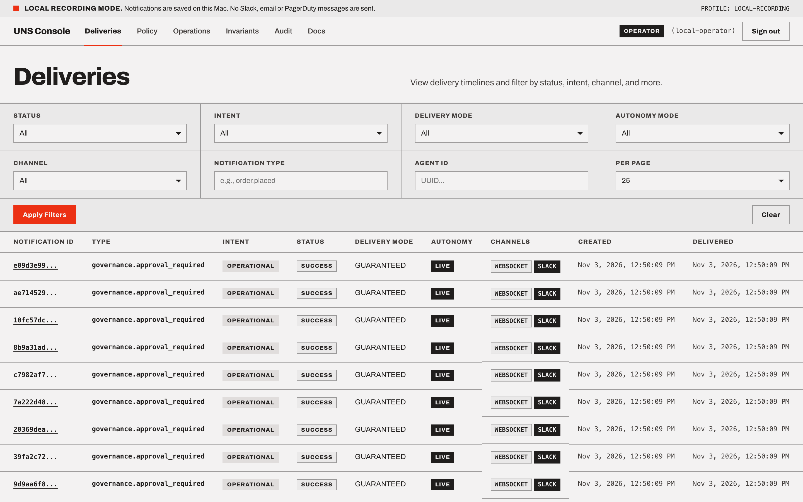
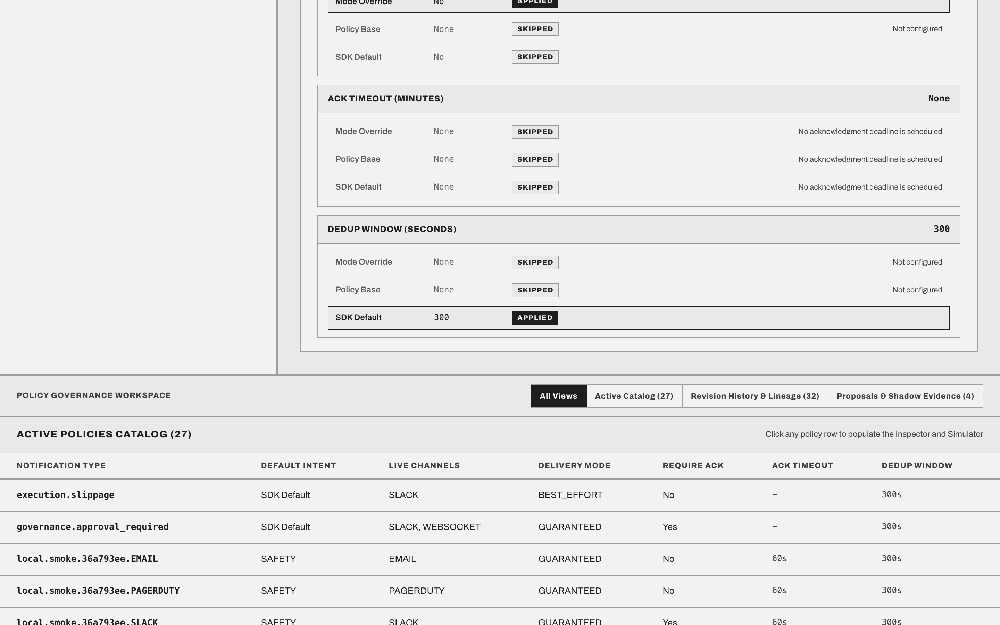
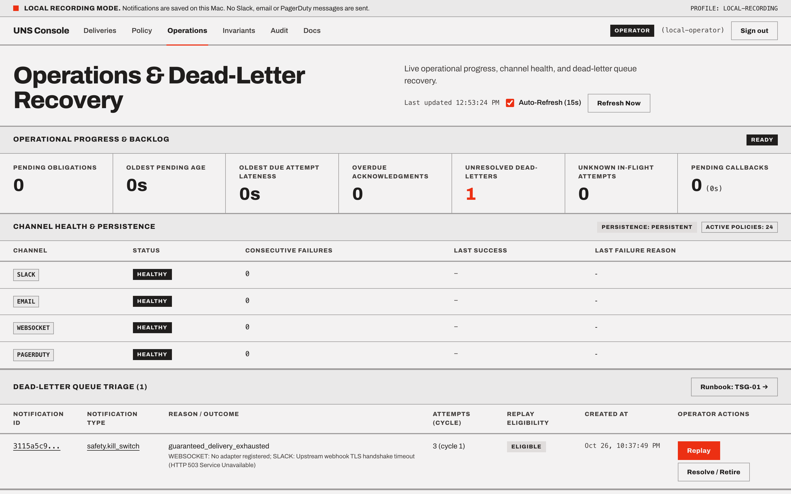

# UNS documentation

<picture>
  <source media="(prefers-color-scheme: dark)" srcset="assets/logo/uns-lockup-dark.svg" />
  <source media="(prefers-color-scheme: light)" srcset="assets/logo/uns-lockup.svg" />
  
</picture>

**Governed notification obligations, immutable policy provenance, and human-in-the-loop supervision for autonomous agents and high-trust backend workflows.**

| Task | Document |
|---|---|
| Evaluate UNS | [Product](PRODUCT.md), [roadmap](ROADMAP.md), [architecture](ARCHITECTURE.md), [delivery semantics](sections/delivery-semantics.md) |
| Quickstart: send a signal | [README](https://github.com/ylecoyote/uns/blob/main/README.md) |
| Configure policies | [Policy lifecycle](sections/policy-lifecycle.md) |
| Integrate an app | [API](API.md), [integration modes](sections/integration-modes.md), [producer integration guide](user-guides/PRODUCER-INTEGRATION-GUIDE.md) |
| Integrate an AI agent (MCP) | [Agent & MCP integration guide](user-guides/AGENT-MCP-GUIDE.md), [API (MCP)](API.md#mcp) |
| Operate and audit | [Deployment](DEPLOYMENT.md), [local runbook](LOCAL_DEPLOYMENT.md), [deployment smoke](DEPLOYMENT_SMOKE.md), [security](SECURITY-MODEL.md), [observability](sections/observability.md), [operator console guide](user-guides/OPERATOR-CONSOLE-GUIDE.md) |
| Support & troubleshoot incidents | [Support state machine & schema](support/STATE-MACHINE-AND-SCHEMA.md), [Troubleshooting Guides (TSG-01 – TSG-06)](tsg/README.md) |
| Extend UNS | [Architecture](ARCHITECTURE.md) |
| Verify implementation | [Testing](TESTING.md), [consolidated baseline](CONSOLIDATED_BASELINE.md) |
| Independent/adversarial review | [External review brief](REVIEW_BRIEF.md), [iteration 2 disposition](REMEDIATION_ITERATION2.md) |
| Migrate existing callers | [Migration](MIGRATION.md) |

## Documentation Tracks

1. **Architecture & Product Contract**
   - [Product Contract](PRODUCT.md) - Core boundaries, obligation semantics, and safety posture
   - [Roadmap (`v0.2.0` → `v1.0.0`)](ROADMAP.md) - Milestone horizons (`v0.3.0`–`v1.0.0`), in-tree scaffolding rationale, and live GitHub Milestones
   - [Architecture](ARCHITECTURE.md) - Durable SQLite outbox (`uns.Runtime`), policy engine, and transport topology
   - [Delivery Semantics](sections/delivery-semantics.md) - Idempotency, deduplication windows, fallback, and ACK lifecycles
   - [Policy Lifecycle](sections/policy-lifecycle.md) - Policy version states (`DRAFT`, `PREVIEW`, `ACTIVE`, `RETIRED`), autonomy modes (`PREVIEW`, `SHADOW`, `LIVE`), and change proposals (`PROPOSED`, `APPROVED`, `APPLIED`)
   - [Security Model](SECURITY-MODEL.md) - Authentication, principal binding, and Console/MCP security boundaries

2. **Deployment & Operations**
   - [Deployment Guide](DEPLOYMENT.md) - Complete environment variable matrix, process topology, reverse-proxy/TLS setup, `uns-migrate`, backups, and `uns-maintain`
   - [Local Deployment Runbook](LOCAL_DEPLOYMENT.md) - Persistent localhost recording stack (`127.0.0.1:8000` and `127.0.0.1:5173`)
   - [Deployment Smoke Report](DEPLOYMENT_SMOKE.md) - Container, socket, and browser verification evidence
   - [Observability & Probes](sections/observability.md) - Health/readiness checks, `/metrics`, structured logs, and SQLite audit queries

3. **Support Reference & Troubleshooting Guides (TSGs)**
   - [State Machine & Schema Reference](support/STATE-MACHINE-AND-SCHEMA.md) - Entity-Relationship diagram, state transition diagrams, and complete column/event reference
   - [Troubleshooting Guides Index](tsg/README.md):
     - [TSG-01: Dead Letter Queue (DLQ) Spikes & Replay](tsg/TSG-01-DLQ-AND-REPLAY.md)
     - [TSG-02: Stuck Leases, Slow Providers & Ambiguous Side Effects](tsg/TSG-02-LEASES-AND-PROVIDER-EFFECTS.md)
     - [TSG-03: ACK Timeouts, Principal Conflicts & Callback Backlog](tsg/TSG-03-ACK-TIMEOUTS-AND-CALLBACKS.md)
     - [TSG-04: Policy Reload Failures & Producer Override Rejections](tsg/TSG-04-POLICY-LIFECYCLE-AND-OVERRIDES.md)
     - [TSG-05: MCP Server (`uns-mcp`) & Agent Integration Recovery](tsg/TSG-05-MCP-AND-AGENT-RECOVERY.md)
     - [TSG-06: Database Maintenance (`uns-maintain`), Retention & Archival](tsg/TSG-06-MAINTENANCE-AND-ARCHIVAL.md)

4. **End-User & Integrator Guides**
   - [Operator Console Guide](user-guides/OPERATOR-CONSOLE-GUIDE.md) - Screen-by-screen walkthrough of the read-only React **UNS Console**
   - [Producer Integration Guide](user-guides/PRODUCER-INTEGRATION-GUIDE.md) - End-to-end recipes for Python (`uns.Client`), HTTP REST, and WebSockets
   - [Agent & MCP Integration Guide](user-guides/AGENT-MCP-GUIDE.md) - Safe MCP host setup, tool catalog, and simulation-first agent workflows

## Console Preview

Historical specifications are indexed in [migration and provenance](MIGRATION.md). They do not override current contracts. The package names `notification` and `uns` are retained implementation/compatibility details, not separate products.
