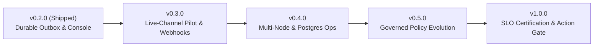

# UNS Roadmap (`v0.2.0` → `v1.0.0`)

This document outlines the architectural direction and milestone boundaries for **UNS (Unified Notification Service)** from the current `v0.2.0` release through `v1.0.0`.

Live execution progress and individual deliverables are tracked natively in [GitHub Milestones](https://github.com/ylecoyote/uns/milestones). To keep this document accurate without commit churn, task checklists live in the linked GitHub Milestones and Issues rather than in this file.

---

## Current Baseline: `v0.2.0` (Shipped)

Release [`v0.2.0`](https://github.com/ylecoyote/uns/releases/tag/v0.2.0) establishes the consolidated, single-repository notification obligation control plane:

- **Durable Transactional Outbox (`uns.Runtime`):** Atomic policy resolution, notification acceptance, leader/follower deduplication ownership, and audit provenance across SQLite (WAL) and PostgreSQL 16 (`psycopg[binary]`).
- **Lease-Fenced Channel Delivery:** Outbound adapters for Slack (`SlackAdapter`), PagerDuty Events API v2 (`PagerDutyAdapter`), Email/SMTP (`EmailAdapter`), and WebSocket (`WebSocketDeliveryAdapter`) with provider-attempt lease guards (`guard_provider_attempt`) and dead-letter replay (`RuntimeDLQ`).
- **Explicit Response & Timeout Lifecycle:** Durable `PENDING -> ACKED | DISMISSED | TIMED_OUT` state machine anchored to first qualifying delivery, with follower inheritance (`obligation_owner_id`, `effective_ack_status`, `ack_inherited`) and retriable host callbacks.
- **Scoped Credential Authority:** Least-privilege capability keys (`UNS_API_KEY`, `UNS_PRODUCER_API_KEY`, `UNS_RESPONDER_API_KEY`, `UNS_OBSERVER_API_KEY`) enforced across HTTP REST, WebSocket, and MCP (`uns-mcp`).
- **6-Surface Responder & Operator Console (`apps/ui`):** React 19 + TypeScript 5.9 + Vite 8 application covering `/deliveries`, `/policy`, `/operations`, `/invariants`, `/audit`, and `/docs`.

See [Product Contract](PRODUCT.md) for current boundaries and [Testing & Verification](TESTING.md) for the `v0.2.0` acceptance matrix (`1,886` Python tests, `23` PostgreSQL 16 + concurrency/load tests, `345` UI tests, and `66/66` persistent localhost checks).

---

## Milestone Horizons

### 1. [`v0.3.0` — Live-Channel Pilot, Bi-Directional Webhooks & Registry Publishing](https://github.com/ylecoyote/uns/milestone/1)

**Goal:** Close the gap between synthetic/recording verification and real external provider mileage, and make `uns` installable directly from public package/container registries.

| Deliverable | Architectural Scope | Status & Tracking Issue |
| :--- | :--- | :--- |
| **First-Party Live-Channel Operational Pilot** | Run a non-recording `uns` deployment wired to live Slack and PagerDuty endpoints for autonomous producer degradation alerts, validating deduplication coalescing and human response latency under real operational traffic. | **Open** · [#39](https://github.com/ylecoyote/uns/issues/39) |
| **Inbound Signed Slack Interactivity Webhook** | Add `POST /api/v1/webhooks/slack` (`X-Slack-Signature` HMAC-SHA256 verification) so clicking the Block Kit `Acknowledge` (`ack_<id>`) and `Dismiss` (`dismiss_<id>`) buttons already emitted by `SlackAdapter` settles the canonical obligation directly from Slack. | **Implemented on `main`** · [#40](https://github.com/ylecoyote/uns/issues/40) |
| **Inbound PagerDuty v3 Webhook Receiver** | Add `POST /api/v1/webhooks/pagerduty` (`X-PagerDuty-Signature` verification) for bi-directional `uns-<dedup_key>` incident acknowledgment and resolution synchronization. | **Implemented on `main`** · [#41](https://github.com/ylecoyote/uns/issues/41) |
| **PyPI & GHCR Release Automation** | Publish `uns` wheels/sdists to PyPI (`pip install uns[full]`) and multi-arch images (`linux/amd64`, `linux/arm64`) to `ghcr.io/ylecoyote/uns` on release tags. | **Implemented on `main`** · [#42](https://github.com/ylecoyote/uns/issues/42) |

---

### 2. [`v0.4.0` — Multi-Node Operations, PostgreSQL Maintenance & Scoped RBAC](https://github.com/ylecoyote/uns/milestone/2)

**Goal:** Provide full operational parity between SQLite and PostgreSQL 16 across multi-worker fleet deployments and multi-tenant producer/responder teams.

| Deliverable | Architectural Scope | Tracking Issue |
| :--- | :--- | :--- |
| **PostgreSQL Retention & Archive-Before-Prune** | Extend `uns-maintain` (currently SQLite-focused) to support `postgresql+psycopg://` retention batches and JSONL archive-before-prune while preserving `dedup_successor_id` replay lineage. | [#43](https://github.com/ylecoyote/uns/issues/43) |
| **Cross-Process Policy Reload Broadcast** | Emit policy revision notifications on `save_snapshot()` / `POST /api/v1/policies/reload` via PostgreSQL `LISTEN/NOTIFY` and Redis pub/sub so warm policy caches refresh immediately across all worker processes. | [#44](https://github.com/ylecoyote/uns/issues/44) |
| **Source- & Namespace-Scoped Credentials** | Allow binding `producer`, `responder`, and `observer` credentials to specific `source` prefixes or tenant namespaces across HTTP, WebSocket, and `uns-mcp`. | [#45](https://github.com/ylecoyote/uns/issues/45) |

---

### 3. [`v0.5.0` — Governed Policy Evolution & Shadow Evaluation Workspace](https://github.com/ylecoyote/uns/milestone/3)

**Goal:** Turn the in-tree `policy_learning` and `policy_learning_store` foundations into an end-to-end shadow evaluation and promotion workflow.

> [!NOTE]
> **Why `policy_learning` is in the repository today:** `src/notification/policy_learning.py` and `src/db/policy_learning_store.py` already implement immutable config envelopes, `PolicyDelta` state transitions (`PROPOSED -> APPROVED -> APPLIED`), guard checks, and `ShadowEvaluationAggregate` gates. In `v0.2.0`, shadow evaluation aggregates are supplied by external evaluators. Milestone `v0.5.0` brings automated shadow execution and operator promotion into the runtime and Console.

| Deliverable | Architectural Scope | Tracking Issue |
| :--- | :--- | :--- |
| **Automated `PREVIEW` Shadow Evaluation Runner** | Evaluate `PREVIEW` candidate policies asynchronously against live intake without triggering external channel sends or mutating live obligation state, recording `ShadowEvaluationResult` samples automatically. | [#46](https://github.com/ylecoyote/uns/issues/46) |
| **Console `/policy` Promotion Workflow** | Add a `Proposals & Shadow Evidence` workspace in `/policy` (`PolicyInspectorPage.tsx`) to inspect sample aggregates, verify guard stages, approve qualifying deltas into `DRAFT`, and explicitly activate `DRAFT -> ACTIVE`. | [#47](https://github.com/ylecoyote/uns/issues/47) |

---

### 4. [`v1.0.0` — Production SLO Certification & Action-Authorization Engine](https://github.com/ylecoyote/uns/milestone/4)

**Goal:** Certify production SLOs backed by sustained live-provider telemetry and resolve the long-term boundary of `uns.governance`.

> [!IMPORTANT]
> **Why `src/uns/governance/` is marked experimental in `v0.2.0`:** As documented in [PRODUCT.md](PRODUCT.md), UNS `v0.2.0` governs **notification obligations** (whether an event was delivered and whether a human responded), not **business-action authorization** (whether an agent is permitted to execute a side effect). The rule schemas, closed operator set, and `DecisionRecord` models in `src/uns/governance/` are preserved from the pre-consolidation control-plane design for `v1.0.0`.

| Deliverable | Architectural Scope | Tracking Issue |
| :--- | :--- | :--- |
| **Multi-Week Production SLO Certification** | Publish sustained operational telemetry receipts (`oldest_pending_age_seconds`, `oldest_due_attempt_lateness_seconds`, `overdue_ack_count`, `unknown_attempt_count`, and provider error rates) from production workloads. | [#48](https://github.com/ylecoyote/uns/issues/48) |
| **Complete or Extract `uns.governance`** | Either complete the deterministic `ALLOW / REQUIRE_APPROVAL / DENY` evaluator and signed approval/resume callback workflow as an opt-in pre-execution gate layered on UNS obligations, or extract `uns.governance` into a standalone companion package. | [#49](https://github.com/ylecoyote/uns/issues/49) |
