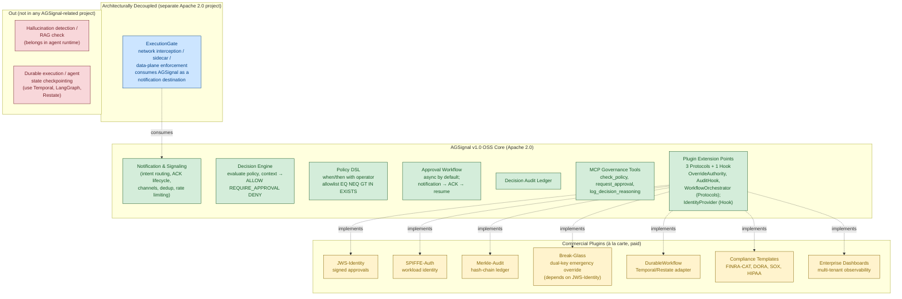
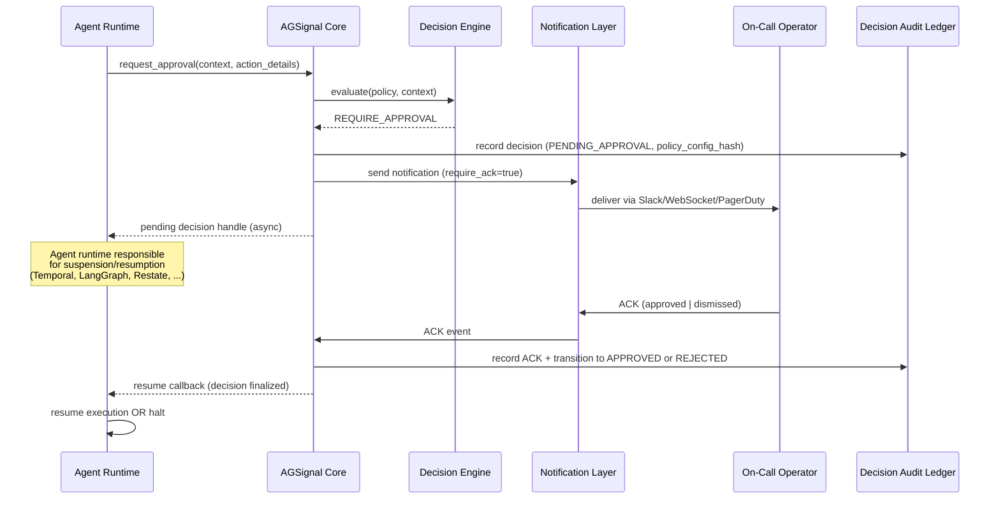

> Historical product vision. Superseded by docs/PRODUCT.md.

# PRD: AGSignal — Agent Governance Signaling Control Plane

| Field | Value |
|---|---|
| Document version | 2.0 (Vision B+) |
| Last updated | 2026-05-08 |
| Status | Canonical |
| Supersedes | v1.x ("Unified Notification & Signaling System") under Vision A scope |
| Authoritative location | `_AGSignal/agent_governance_control_plane_prd.md` |

> **Major version note (2.0):** This PRD has been re-scoped from Vision A (comprehensive governance product with sidecar interception, ODRL DSL, JWS-mandated approvals, SPIFFE/SPIRE workload identity, Merkle ledger, FPGA latency tier, hallucination detection) to **Vision B+: a domain-agnostic governance control plane with a plugin ecosystem**. Crypto/identity/durability/compliance features now live in **commercial plugins** layered on top of OSS core extension points. Network interception is **architecturally decoupled** to a separate ExecutionGate project. See §11 (Open ADR-Pending Items) and the design-sync conflict report at `docs/internal/superpowers/specs/2026-05-08-stage1-design-sync-report.md` for the rationale behind each change.

---

## 1. Overview

### 1.1 One-line Summary

AGSignal is the **runtime HITL (Human-in-the-Loop) Approval Control Plane for AI agents** — the neutral, vendor-portable primitive (`REQUIRE_APPROVAL → notification → human ACK → resume callback`) that cloud-vendor agent-governance stacks (Microsoft Agent 365 + AGT, AWS Bedrock AgentCore, Google Vertex AI Governance) and framework-native HITL features don't ship as a first-class product. AGSignal **complements** those stacks via cloud-stack bridge plugins; it does not compete with them. Apache 2.0 OSS core; commercial plugins (Stack Bridges, identity/crypto, durable workflow, compliance templates) layered on stable extension points.

### 1.2 Background

#### 1.2.1 The Compliance-Autonomy Paradox

Regulated enterprises face a structural conflict between the velocity of autonomous AI agents and the deterministic controls mandated by regulators such as the EU's Digital Operational Resilience Act (DORA) and the US Financial Industry Regulatory Authority (FINRA). Agents reason, plan, and execute multi-step workflows; existing governance frameworks were designed for deterministic systems with explicit code paths. The result is a paradox: institutions must harness agent autonomy *and* enforce rigid, auditable controls.

This paradox is not specific to financial services. Healthcare, critical infrastructure, defense, and any domain operating under SOX, HIPAA, or equivalent regimes encounter the same pattern: an agent must take an action; a human (or policy) must be in the loop; the entire decision must be auditable; the agent must be able to *resume* once approval is granted, without losing context.

#### 1.2.2 Why a separate control plane

Solving this paradox in every agent runtime is wasteful and error-prone. The governance concerns — policy evaluation, approval workflow, signed audit, identity, notification routing — are common across domains. They are also high-stakes: a bug in approval logic can cascade into regulatory liability. AGSignal extracts these concerns into a dedicated control plane that agent runtimes (and domain-specific governors) integrate against.

#### 1.2.3 Why a plugin ecosystem (not "core + enterprise edition")

Vision A bundled identity, crypto, compliance templates, and durable execution into the core specification. Vision B+ unbundles them. Most users need a small, well-understood OSS core. A subset of users (regulated enterprises) need cryptographic non-repudiation, signed approvals, immutable hash-chained audit, and pre-built compliance templates. These features are valuable; they are also proprietary in nature and best maintained as commercial plugins layered on stable extension points, rather than mandates baked into the OSS core.

#### 1.2.4 Pre-execution-first positioning

Stage 2 research identified three semantically distinct gate types in production governance systems: **pre-execution gates** (authorization controls — block before side effects), **in-execution gates** (enforcement controls — sidecar/inline runtime constraints), and **post-execution gates** (assurance controls — retrospective review and reconciliation). AGSignal v1 is **pre-execution-first**: it serves as the authorization control plane that produces decision artifacts and approval workflows *before* an action's side effects occur.

AGSignal explicitly does **not** claim:
- **In-execution enforcement** ownership (that's the **ExecutionGate** sibling project's responsibility — sidecar/network interception runs in the data plane).
- **Post-execution review** ownership (retrospective review, reconciliation, and compensation are downstream concerns; AGSignal's audit streams provide *authorization evidence*, not execution evidence).

Real-world architectures typically combine all three tiers: high-risk actions get pre-execution approval; medium-risk get in-execution constraints; low-risk get post-execution review. AGSignal does not implement the action classifier that routes between tiers — the classifier is a caller-side concern. AGSignal serves the pre-execution tier with strong primitives (decision evaluation, approval workflow, immutable audit, MCP tools) and integrates with sibling projects for the other tiers.

### 1.3 Target Audience

Per Stage 2 competitive analysis, demand for runtime HITL approval is concentrated in three buyer segments, each with budget today:

**Segment 1 — Regulated and high-stakes automation (primary buyer; budget pressure highest)**

- **Chief Compliance Officers (CCOs)** in financial services, healthcare, legal, and critical infrastructure — already evaluating EU AI Act Article 14, GDPR Article 22, FINRA Rule 3110, SEC Rule 15c3-5, DORA Article 17 readiness for AI-agent deployments
- **Heads of Algorithmic Trading** and equivalent roles where money movements, irreversible API calls, and externally visible actions require human approval
- **Regulatory bodies (external)** as audit-evidence consumers — SEC, FINRA, ESAs, and equivalent

This segment buys: AGSignal core + Compliance Templates plugin + JWS-Identity / Merkle-Audit for non-repudiation. Highest dollar value per customer; lowest objection to commercial plugin pricing.

**Segment 2 — Agent platform teams operationalizing tool approval and runtime governance**

- Engineering leaders deploying **Microsoft Agent 365 + Agent Governance Toolkit**, **AWS Bedrock AgentCore**, or **Google Vertex AI Agent Governance** who need the missing HITL approval layer that composes with their existing platform investment
- DevOps / SRE teams responsible for the operational reliability of agent fleets and the on-call signal path

This segment buys: AGSignal core + Stack Bridge plugin (Microsoft / AWS / GCP). Validates the complementary positioning; lowest friction to adoption.

**Segment 3 — Custom-agent builder teams**

- Engineering teams building custom AI-agent applications on **LangGraph**, **AutoGen**, **CrewAI**, or framework-only stacks — currently stitching approval flows together from Slack approval buttons + custom callback handlers + email links + webhook receivers + Temporal workflows + manual UIs
- Independent product teams without enterprise cloud-vendor commitments

This segment adopts: AGSignal core OSS only (initially); upgrades to commercial DurableWorkflow plugin when production durability matters. Largest top-of-funnel; lowest dollar value per customer.

---

## 2. Architectural Commitments (Load-Bearing)

These eight commitments shape every decision in this PRD. They cannot be violated by feature requests without revisiting the document at the version-major level.

### 2.1 AGSignal core never participates in execution

AGSignal is a **control plane**. It does not intercept network traffic, route trades, suspend in-flight execution loops, or block API calls between an agent and an external service. It evaluates policy, signals notifications, captures ACKs, audits decisions, and emits resume callbacks. Network-level enforcement, if required, is the responsibility of a separate **ExecutionGate** project (Apache 2.0; out of scope for this PRD) that consumes AGSignal as a notification destination.

This is the hard constraint preserved from the v0.2 functional spec. Any feature proposal that would require AGSignal to participate in execution timing is rejected at the scope filter, not at the design stage.

### 2.2 Domain-specific governance lives in plugins, not core

Trading-specific concepts (`notional_usd`, plan lifecycles, order_count thresholds), healthcare-specific concepts (patient ID, PHI access, consent state), and any other vertical concerns belong in **domain plugins**, not in the core. The core operates over generic field names and operator allowlists. Plugins translate domain semantics into the generic shape and back.

The domain plugin contract evolves in two stages:

- **v1 — adapter shape**: domain code owns context-capsule construction, registers its `ContextSchema` with the engine, calls `agsignal.governance.evaluate(policy, context)`, and translates `ALLOW | REQUIRE_APPROVAL | DENY` back into domain semantics.
- **v2+ — Protocol shape**: AGSignal defines an `AgentGovernor` Protocol that domain plugins implement. The Protocol is extracted from the v1 adapter shape only after a second domain plugin confirms which abstractions are stable.

### 2.3 Crypto, identity, durability, compliance live in commercial plugins on top of core extension points

There is no "AGSignal Enterprise Edition." The OSS core defines extension points (Protocols and hooks; see §2.6). Commercial plugins implement them. Customers pick the plugins they need à la carte: JWS-Identity if they need signed approvals, SPIFFE-Auth if they need workload identity, Merkle-Audit if they need cryptographic non-repudiation, and so on. Each plugin is independently licensed and independently versioned.

### 2.4 Approval Workflow is async by default, callback/webhook-driven

The default Approval Workflow is asynchronous and **callback/webhook-driven**. The caller provides a `callback_url` (or webhook target) when calling `evaluate()`; AGSignal stores it with the pending decision; on ACK, AGSignal POSTs the finalized decision (with `decision_id` for idempotent resume) to the callback URL. **Polling is supported as a fallback transport** (`GET /decisions/<id>/status`) for callers without webhook infrastructure but is not the recommended default — production literature consistently identifies polling as the weakest option.

The engine never blocks waiting internally. The agent runtime is responsible for managing its own suspension/resumption — typically via a durable orchestrator (Temporal, LangGraph, Restate). Synchronous "block until approved" semantics are *not* a core concern; if they are needed, they are introduced by a plugin that wraps the async API. The exact retry/timeout/escalation contract for callback semantics is **ADR-pending** (see §11, ADR-001).

### 2.5 Decision Engine is two-layer (pure `decide()` + impure `evaluate()` wrapper)

Decision logic is a **pure function** `decide(policy, context) → DecisionRecord` — testable, side-effect-free, deterministic. The `evaluate()` engine API wraps `decide()` with audit-ledger persistence and metric emission (impure). Tests target `decide()` directly; integration targets `evaluate()`. This separation prevents the common confusion where "pure function" framing is contradicted by audit-write requirements.

### 2.6 Plugin extension points distinguish stable Protocols from callable hooks

Extension points come in two tiers:

- **Stable Protocols** (clear contract, multi-system precedent): `OverrideAuthority` (single-method), `AuditHook` (single-method), and `WorkflowOrchestrator` (five-method portable contract: `createApprovalWait` / `resumeApproval` / `expireApproval` / `queryApproval` / `fetchAudit`). The `WorkflowOrchestrator` Protocol shape is validated by Stage 2 production-pattern matrix research showing it maps cleanly across Temporal signals, Step Functions task tokens, Restate awakeables, Airflow HITL tasks, and custom orchestrators.
- **Callable hooks** (v1; promote to Protocols when ≥2 implementations validate the abstraction): `IdentityProvider`. The three production identity shapes (HMAC session tokens, signed JWS payloads, SPIFFE SVIDs) are genuinely different at the contract level — they don't share a common 5-method or 3-method shape the way orchestrator approval workflows do — so a unified Protocol is premature until production usage clarifies which abstractions are stable.

This avoids the premature-abstraction trap while keeping plugin authoring viable.

### 2.7 Audit is three correlated streams

The audit substrate is **three semantically distinct streams**, correlated by `correlation_id` + `decision_id`:

- **Decision Audit** — every Decision Engine evaluation. The policy decision event.
- **Approval Audit** — every human ACK / DISMISS / TIMED_OUT. The human decision event.
- **Delivery Audit** — every notification delivery / failure / retry. The transport event.

These are NOT one ledger. **Approval completion is not proof of policy correctness** — the ACK proves a human agreed; the Decision Audit records what the policy evaluated. They are correlated but semantically distinct.

### 2.8 Event schema is custom Pydantic; CloudEvents adoption is deferred to ADR

Vision A mandated a CloudEvents envelope for every event. Vision B+ uses a custom Pydantic schema (already shipped in v0.2 for notifications) **with envelope/data separation**: top-level fields are AGSignal-specific (e.g., `notification_id`, `intent`, `delivery_mode`), business payload lives in `metadata: dict`. This enables a low-cost CloudEvents retrofit if adopted post-v1 without forcing it now. CloudEvents adoption is **ADR-pending** (see §11, ADR-002).

### 2.9 Architectural Rationale: lightweight built-in Approval Workflow

AGSignal core's inclusion of Approval Workflow inside the OSS core is a deliberate design choice. Stage 2 production-pattern research identified five viable HITL approval patterns: (A) PDP + Temporal signals, (B) Step Functions callback token, (C) Restate awakeables, (D) Airflow 3.1 HITLOperator, (E) Casbin enforcer + custom orchestrator. AGSignal's positioning across these:

- **OSS core (v1)**: ships an in-process **lightweight built-in orchestrator** behind the `WorkflowOrchestrator` Protocol — Pattern A-shaped (PDP + lightweight workflow) but in-memory rather than Temporal-durable. Sufficient for non-regulated deployments. ACK lifecycle, timeouts, escalation; non-durable across platform restart.
- **Commercial DurableWorkflow plugin**: maps to Pattern A (Temporal adapter) or Pattern C (Restate adapter), implementing the same `WorkflowOrchestrator` Protocol with durable backends. Customers needing exactly-once resume, multi-day pending approvals, or worker-restart survival install this plugin.

This gives "OSS core useful standalone for non-regulated deployments" without forcing every adopter to install a durable orchestrator. The Protocol contract — five methods, validated by matrix research — keeps swapping backends a configuration change rather than a rewrite.

---

## 3. Scope Boundary

The diagram below names what is **inside the AGSignal repo (v1.0 OSS core)**, what is **architecturally decoupled** (separate project), what is **deferred to commercial plugins**, and what is **out entirely**.



---

## 4. User Stories

### 4.1 Primary user personas

- **Agent Runtime Developer** — integrates AGSignal into an agent platform; uses MCP tools and the Decision Engine.
- **Domain Plugin Author** — builds a domain-specific governor (e.g., MIP-AG-Trading) on top of AGSignal core via the adapter shape.
- **Compliance Officer** — defines governance policy YAML, reviews ACKs and audit ledger entries, signs off on approval requests.
- **On-Call Operator** — receives notifications, ACKs or dismisses them, manages break-glass when commercial Break-Glass plugin is installed.
- **Commercial Plugin Vendor** — implements an extension-point Protocol (e.g., `AuditHook`) for a paid plugin.

### 4.2 Core user stories

```
As an Agent Runtime Developer
I want to call check_policy(action) before invoking a tool
So that the agent can pre-validate the action and avoid unnecessary rejection cycles.
```

```
As an Agent Runtime Developer
I want to call request_approval(context, action_details) when the agent encounters a high-stakes decision
So that a human reviewer is notified and the agent can resume once the decision is rendered.
```

```
As a Domain Plugin Author
I want to construct my own context capsule (e.g., trading-specific fields like notional_usd, order_count)
And call agsignal.governance.evaluate(policy, context)
So that domain logic stays in my plugin and AGSignal remains domain-agnostic.
```

```
As a Compliance Officer
I want to author governance policy YAML using when/then rules with an operator allowlist
So that policies are auditable, version-hashed, and enforceable without ad-hoc code.
```

```
As a Compliance Officer
I want every governance decision recorded in an immutable Decision Audit Ledger keyed by policy_config_hash
So that I can prove which policy version produced which decision when challenged.
```

```
As an On-Call Operator
I want safety notifications to deliver via Slack, WebSocket, and PagerDuty (when irreversible)
And to require ACK in LIVE autonomy mode
So that I can intervene before an irreversible action ships.
```

```
As a Commercial Plugin Vendor
I want stable extension point contracts (Protocols where multi-system precedent exists, callable hooks elsewhere) I can implement against
So that my plugin (SPIFFE-Auth, DurableWorkflow, JWS-Identity, etc.) works against any AGSignal version that satisfies the contract.
```

### 4.3 User Journey: Approval Workflow



### 4.4 Use cases

1. **Pre-validation of a tool call**: agent calls `check_policy(action)` with a tentative action; receives `ALLOW | REQUIRE_APPROVAL | DENY` and a reason; chooses whether to proceed, ask for approval, or abandon.
2. **High-stakes action approval**: agent calls `request_approval(context, action_details)`; AGSignal evaluates policy, emits notification, captures ACK, calls back into the agent runtime once decision is finalized.
3. **Reasoning trace audit**: agent calls `log_decision_reasoning(trace_id, content)` to attach chain-of-thought or rationale to a decision in the audit ledger.
4. **Policy authoring**: compliance officer writes governance policy YAML with `when`/`then` rules, deploys via the policy lifecycle (DRAFT → PREVIEW → ACTIVE → RETIRED).
5. **Domain plugin integration**: MIP-AG-Trading constructs a trading-specific context, calls `agsignal.governance.evaluate(policy, context)`, translates the response back into ATP plan transitions. (Illustrative example; see §8.)
6. **Commercial plugin integration**: an enterprise installs JWS-Identity to require signed approvals; the IdentityProvider extension point is now satisfied by JWS rather than the OSS default.
7. **Decoupled execution enforcement**: an HFT operator deploys ExecutionGate alongside AGSignal; ExecutionGate intercepts orders and consults AGSignal for governance decisions; AGSignal itself never sits in the data path.

---

## 5. Functional Requirements

This section enumerates requirements using MoSCoW prioritization for the OSS core. Commercial-plugin features appear in §6 (deferred); decoupled / out features in §7.

### 5.1 Must Have (MVP for v1.0 OSS core)

#### M1. Notification & Signaling Layer (existing, already shipped in v0.2)

- [ ] **M1.1** Intent-based routing: `SAFETY`, `GOVERNANCE`, `OPERATIONAL`, `INFORMATIONAL`.
  - AC: A notification with `intent=SAFETY` and `autonomy_mode=LIVE` MUST route to Slack + WebSocket and add PagerDuty when `irreversible=true`. Unit test verifies channel set per intent × autonomy_mode.
- [ ] **M1.2** Autonomy-aware delivery: `PREVIEW`, `SHADOW`, `LIVE` modes, with per-mode channel and ACK overrides.
  - AC: `autonomy_mode=PREVIEW` MUST override channels to `[WEBSOCKET]` for all intents and MUST set `require_ack=false` unless explicitly overridden by policy.
- [ ] **M1.3** ACK lifecycle: `PENDING → ACKED | DISMISSED | TIMED_OUT`.
  - AC: Repeated ACK for the same `notification_id` MUST be idempotent. SAFETY timeout MUST trigger re-escalation per policy.
- [ ] **M1.4** Channel adapters: Slack, Email, WebSocket, PagerDuty.
  - AC: Each adapter MUST expose `deliver(notification)` and `health_check()`. Failures MUST raise (not be swallowed).
- [ ] **M1.5** Declarative YAML policies, versioned and hashed.
  - AC: Policy lifecycle MUST be `DRAFT → PREVIEW → ACTIVE → RETIRED`. Every active policy MUST have a `policy_config_hash` recorded in audit entries.
  - AC: **Hot-reload version pinning**: when policies are hot-reloaded, in-flight evaluations MUST continue with the policy version they started (pinned via `policy_config_hash`). New evaluations use the new version. Version-drift mid-decision is rejected as an anti-pattern.
- [ ] **M1.6** Deduplication, rate limiting, dead-letter queue, delivery audit.
  - AC: Second notification with the same `dedup_key` within the configured window MUST be deduplicated. Token-bucket rate limit MUST be enforced per channel.

#### M2. Decision Engine (new in v0.4–v0.6)

The Decision Engine is **two-layer** (Architectural Commitment §2.5):

- [ ] **M2.1** Pure decision function: `decide(policy, context) → DecisionRecord`. Side-effect-free, deterministic, fully testable in isolation.
  - AC: `decide()` MUST NOT perform I/O — no DB writes, no network calls, no audit emission. Tests MUST exercise `decide()` directly.
  - AC: Engine MUST be domain-agnostic — it MUST NOT reference any vertical-specific field name. All domain semantics MUST come from the `context` argument and the `policy` rule definitions.

- [ ] **M2.2** Impure engine wrapper: `evaluate(policy, context, *, callback_url=None, correlation_id=None) → DecisionRecord`. Wraps `decide()` with audit-ledger persistence, metric emission, and (when outcome is REQUIRE_APPROVAL) registration of the pending decision with the Approval Workflow.
  - AC: `evaluate()` MUST write a Decision Audit Ledger entry on every invocation, regardless of outcome.
  - AC: `evaluate()` MUST NOT block waiting for human approval. If outcome is REQUIRE_APPROVAL, it returns the pending DecisionRecord; the Approval Workflow handles ACK and callback asynchronously.

- [ ] **M2.3** **`DecisionRecord` schema (locked at v0.4 to avoid v0.5 breaking changes; expanded 2026-05-08 per Stage 2 production-audit research)**. The schema MUST contain at minimum:

  ```
  # Required (always populated, including in single-tenant non-traced deployments)
  decision_id          : UUID         # deterministic, idempotency key for resume
  policy_config_hash   : str          # hash of the GovernancePolicy YAML at evaluation time
  policy_id            : str          # human-readable policy identifier
  policy_version       : str          # semantic version
  engine_version       : str          # semver of evaluator implementation, distinct from policy_version
  context_hash         : str          # hash of the context capsule (audit without storing raw context)
  decision             : enum         # ALLOW | REQUIRE_APPROVAL | DENY
  reasons              : list[Reason] # structured (rule_id, matched, predicate, then) per ADR Decision Engine Internal Shape
  evaluated_at         : timestamp    # RFC 3339, UTC
  schema_version       : str          # DecisionRecord schema version, separate from policy/engine version
  subject_id           : str          # who initiated the request (resolved via IdentityProvider hook)

  # Optional (None when not applicable; SHOULD be populated when context permits)
  correlation_id       : str | None   # cross-AGSignal-stream forensic linkage (Decision + Approval + Delivery)
  trace_id             : str | None   # distributed-trace integration (W3C Trace Context / OpenTelemetry); distinct from correlation_id
  span_id              : str | None   # sub-trace causal node
  parent_span_id       : str | None   # trace tree reconstruction
  tenant_id            : str | None   # multi-tenant scoping (org_id / account_id alias acceptable)
  resource_id          : str | None   # what the decision was about (model / tool / file / account / transaction)
  resource_type        : str | None   # taxonomy of resource_id
  parent_decision_id   : str | None   # replay/re-evaluation chain (NOT correlation_id; semantically distinct)
  request_origin       : RequestOrigin | None  # structured: ip, hostname, region, jurisdiction
  model_id             : str | None   # AI provenance — model identifier (when agent provenance is recorded)
  model_version        : str | None   # paired with model_id
  ```

  Additional fields MAY be added in minor versions; existing fields MUST NOT be removed or have semantics changed without a major version bump.

  - AC: `DecisionRecord` MUST be the canonical return type from both `decide()` and `evaluate()`. Callers downstream of either entrypoint MUST be able to consume the same shape.
  - AC: **`correlation_id` and `trace_id` are semantically distinct.** `correlation_id` is for cross-AGSignal-stream linkage (Decision + Approval + Delivery audit streams). `trace_id` is for distributed-trace integration with the caller's tracing infrastructure (W3C Trace Context / OpenTelemetry). They MUST NOT be conflated; populating one does not satisfy the other.
  - AC: **`subject_id` is required even in OSS single-tenant deployments.** The Default IdentityProvider (M8.4) resolves it from HMAC session tokens; alternatives via JWS-Identity / SPIFFE-Auth commercial plugins.
  - AC: **`parent_decision_id` is the replay/re-evaluation linkage**, not `correlation_id`. A re-evaluation after policy changes, context changes, or operator correction MUST set `parent_decision_id` to the prior `decision_id`.
  - AC: **`request_origin` is structured, not a single string** — IP, hostname, region, and jurisdiction are separate fields. Single-string origins (e.g., URLs, hostnames alone) are insufficient for forensic jurisdiction analysis.
  - AC: Fields explicitly **deferred** from v0.4 (per Stage 2 research): `confidence` / `risk_score` (false precision; engine is deterministic); `cost_center` / `billing_id` (downstream attribution, not core); rigid `geo_region` (derive from `request_origin` or tenant metadata); `retry_count` (use `parent_decision_id` instead).

- [ ] **M2.4** Engine **fail-mode** semantics on attribute-source unreachable / context-evaluation throw / malformed policy at hot-reload: default fail-closed for `intent ∈ {SAFETY, GOVERNANCE}`; configurable per-intent for OPERATIONAL/INFORMATIONAL. **ADR-pending** (see §11, ADR-008).

- [ ] **M2.5** Internal engine shape (pure function vs state machine vs hybrid) is **ADR-pending** (see §11, ADR-007). The two-layer commitment (M2.1 + M2.2) is locked; the internal structure of `decide()` is not.

#### M3. Policy DSL

- [ ] **M3.1** `when`/`then` rule structure. `when` is a predicate over `context`; `then` is one of `ALLOW`, `REQUIRE_APPROVAL`, `DENY`, optionally with a reason and a target reviewer role.
  - AC: Policy YAML MUST be parsed deterministically. Two identical policies MUST produce identical `policy_config_hash`.
- [ ] **M3.2** Operator allowlist: `EQ`, `NEQ`, `GT`, `GTE`, `LT`, `LTE`, `IN`, `NOT_IN`, `EXISTS`, `NOT_EXISTS`, `MATCHES` (regex; bounded).
  - AC: Operators outside the allowlist MUST be rejected at policy load. Regex MUST be subject to a length and complexity cap to prevent ReDoS.
- [ ] **M3.3** Domain-agnostic field names. The DSL takes paths into the supplied `context` map; AGSignal does not reserve trading-specific or any other domain-specific names.
  - AC: Two policies authored against different domains (e.g., a trading policy and a healthcare-PHI-access policy) MUST be parseable by the same loader without code change.
- [ ] **M3.4** **`ContextSchema` registration** for type-safe domain integration. Domain code registers a declarative schema (allowed fields, types, validation rules) at engine construction time. The engine validates every `context` capsule and every policy field reference against the registered schema at policy-load time.
  - AC: Policies referencing fields not in the registered `ContextSchema` MUST be rejected at load time, not at evaluation time.
  - AC: Multi-domain coexistence (e.g., MIP-AG-Trading and a healthcare plugin running in the same process) MUST be supported via per-engine-instance schemas. **ADR-pending**: schema versioning and evolution rules (see §11, ADR-009).

#### M4. Capability / Constraint Framework

- [ ] **M4.1** Generic primitives: `max_*`, `*_allowlist`, `must_have_*`.
  - AC: Authors of domain plugins MUST be able to express common constraints (e.g., "max value 1,000,000", "symbol must be in allowlist", "context must have approval_id") without inventing new operators.
- [ ] **M4.2** Constraints compose with the operator allowlist (M3.2). They are not a parallel DSL; they are a convention layer over the same engine.

#### M5. Approval Workflow

- [ ] **M5.1** `REQUIRE_APPROVAL → notification (require_ack=true) → ACK → APPROVED → callback`.
  - AC: When the Decision Engine returns `REQUIRE_APPROVAL`, AGSignal MUST emit a notification carrying the `decision_id` and MUST register the caller-supplied `callback_url` (if any) with the pending decision.
- [ ] **M5.2** **Callback/webhook by default** (Architectural Commitment §2.4). On ACK, AGSignal POSTs the finalized DecisionRecord to the registered `callback_url` with `decision_id` for idempotent resume.
  - AC: Callback POST MUST be retried with exponential backoff on failure (default: 3 retries over ~10 minutes; configurable).
  - AC: Callback failure after retries MUST surface as a Delivery Audit entry AND a degraded-decision marker; it MUST NOT silently lose the approved decision.
  - AC: Callback signing (HMAC) using the Default IdentityProvider's session key MUST be supported, so callers can verify callback authenticity.
  - AC: **Receiver-side idempotency requirement**: callers MUST handle duplicate callback POSTs idempotently using `decision_id` as the dedup key. AGSignal's at-least-once retry semantics combined with caller's idempotent receive yields effectively-once resume. (Per Stage 2 production-pattern research: even orchestrators with exactly-once wake-up semantics like Restate awakeables require idempotent receivers; AGSignal does not promise stronger semantics than its caller can absorb.)
- [ ] **M5.3** **Polling fallback transport** for callers without webhook infrastructure: `GET /decisions/<decision_id>/status` returns the current decision state and (when finalized) the full DecisionRecord.
  - AC: Polling MUST be eventually consistent with callback delivery. Documented as fallback-only; the recommended integration pattern is callback.
- [ ] **M5.4** Engine never blocks waiting internally. The agent runtime is responsible for its own suspension/resumption (typically via a durable orchestrator).
  - AC: The core API MUST return a pending handle (DecisionRecord with `decision = REQUIRE_APPROVAL`); it MUST NOT block the calling thread.
- [ ] **M5.5** Decision lifecycle: `PENDING_POLICY → PENDING_APPROVAL → APPROVED | REJECTED | TIMED_OUT`.
  - AC: State transitions MUST be auditable in the **Approval Audit** stream (M6.2); out-of-order transitions MUST be rejected.
- [ ] **M5.6 (sync wrapper)** Synchronous wrapper API and detailed retry/timeout/escalation semantics are **ADR-pending**. (See §11, ADR-001.)

#### M6. Audit Ledger (Three Correlated Streams)

Audit is implemented as **three semantically distinct, append-only streams**, correlated by shared keys (Architectural Commitment §2.7). Approval completion is **not** proof of policy correctness; the ACK proves a human agreed; the Decision Audit records what the policy evaluated. They are correlated but semantically distinct.

- [ ] **M6.1** **Decision Audit** — every Decision Engine evaluation (M2.2). Records the policy decision event.
  - AC: Every `evaluate()` call MUST produce one Decision Audit entry containing the full `DecisionRecord` (M2.3) plus `agent_id` and ingestion timestamp.
- [ ] **M6.2** **Approval Audit** — every human ACK / DISMISS / TIMED_OUT in the Approval Workflow (M5). Records the human decision event.
  - AC: Every approval-lifecycle transition MUST produce one Approval Audit entry referencing `decision_id` and including `approver_id` (resolved via IdentityProvider; M8.4).
  - AC: Approval Audit entries MUST NOT be merged into Decision Audit entries — they are semantically distinct events.
- [ ] **M6.3** **Delivery Audit** — every notification delivery / failure / retry (existing v0.2; M1).
  - AC: Existing v0.2 invariants preserved. GUARANTEED delivery semantics unchanged.
- [ ] **M6.4** **Cross-stream correlation**: all three streams MUST share `correlation_id` (caller-supplied) and `decision_id` (engine-generated) where applicable. An auditor querying any one stream MUST be able to follow the keys into the other two.
  - AC: An external query "give me all events for `correlation_id=X`" MUST return Decision Audit + Approval Audit + Delivery Audit entries in time order.
- [ ] **M6.5** **Policy retrieval**: shared `policy_config_hash` enables auditor recovery of the exact policy YAML that produced any Decision Audit entry.
- [ ] **M6.6** **Immutability** (OSS core): ledger entries are append-only at the API level. Optional **hash-chain semantics** (each entry includes the hash of the prior entry) are available as an OSS feature; a stronger Merkle-tree attestation is provided by the commercial **Merkle-Audit plugin** (§6).
  - AC: Tampering with a ledger entry MUST be detectable by re-validating the OSS hash chain. The chain root is exposed via API for external attestation.
  - **Note**: Physical storage layout (one table with stream tag, three separate tables, or stream-specific stores) is **ADR-pending** (see §11, ADR-003).

#### M7. MCP Governance Tools (Semantic Tiers)

The three MCP governance tools have **semantically distinct contracts** (Architectural Commitment §2.7 derivation; aligns with emerging MCP governance practice):

- [ ] **M7.1** `check_policy(action) → DecisionRecord` — **READ-only** contract. Deterministic preflight; side-effect free.
  - AC: MUST NOT create an audit entry. MUST NOT mutate state. MUST evaluate the same `decide()` path used by `request_approval`, but MUST short-circuit before `evaluate()`'s ledger-write side effect.
  - AC: Repeated calls with identical `action` MUST return identical `DecisionRecord` outcomes (deterministic).

- [ ] **M7.2** `request_approval(context, action_details, callback_url=None) → DecisionRecord` — **WRITE (durable)** contract. Creates a pending decision and a callback token.
  - AC: MUST always create a Decision Audit entry (M6.1).
  - AC: MUST emit a notification when the decision outcome is `REQUIRE_APPROVAL`.
  - AC: MUST register the `callback_url` (or webhook target) with the pending decision for asynchronous resume (M5.2).
  - AC: Idempotency on `decision_id` — repeated calls with the same `decision_id` MUST NOT create duplicate audit entries or duplicate notifications.

- [ ] **M7.3** `log_decision_reasoning(trace_id, content) → AuditRecordRef` — **WRITE-LOG** contract. Immutable audit capture; **NOT** the source of truth for authorization.
  - AC: MUST write to the Decision Audit stream (M6.1) as an attached record referencing `trace_id` (typically the `decision_id` or a parent span id).
  - AC: Content MUST be **structured**: a list of `(when_clause_id, matched: bool, predicate_evaluation: str)` entries enabling "why was this denied?" reconstruction predicate-by-predicate. Free-form prose is allowed as an additional field but MUST NOT be the only content.
  - AC: MUST cap content size (configurable; suggested default 64 KB).
  - AC: An entry written via `log_decision_reasoning` is **audit evidence**, not authorization. The Decision Engine MUST NOT consult these entries during `decide()` or `evaluate()`.

- [ ] **M7.4** MCP transport selection (stdio / SSE / streamable-http / multiple) is **ADR-pending** (see §11, ADR-006).

#### M8. Plugin Extension Points (Two Tiers)

Per Architectural Commitment §2.6, extension points come in two tiers: **stable Protocols** (clear contract, multi-system precedent) and **callable hooks** (v1; promote to Protocols at ≥2 implementations or proven-stable contract).

##### M8.A. Stable Protocols (defined as Protocols in v1)

- [ ] **M8.1** `OverrideAuthority` Protocol — for break-glass / emergency override decisions. Single-method, well-precedented (analogous to OPA decision overrides).
  - AC: Default OSS implementation MUST be a single-key override gated by an operator role check. Commercial **Break-Glass plugin** MAY replace it with a dual-key implementation (see §6).
- [ ] **M8.2** `AuditHook` Protocol — for additional audit destinations (privileged, extended, or external). Single-method, well-precedented (analogous to OpenTelemetry exporters).
  - AC: Default OSS implementation MUST write to the local Audit streams (M6.1, M6.2, M6.3). Commercial **Merkle-Audit plugin** MAY add hash-chain attestation and external publication (see §6).
- [ ] **M8.3** `WorkflowOrchestrator` Protocol — for orchestrating approval workflow state and resume. **Five-method portable contract** validated by Stage 2 production-pattern matrix research (Pattern A Temporal signals, Pattern B Step Functions callback tokens, Pattern C Restate awakeables, Pattern D Airflow HITL tasks, Pattern E custom orchestrator):

  ```
  createApprovalWait(decisionContext) → waitHandle
  resumeApproval(waitHandle, outcome)
  expireApproval(waitHandle)
  queryApproval(waitHandle) → status
  fetchAudit(correlationId) → events[]
  ```

  - AC: Default OSS implementation MUST be a **lightweight in-memory orchestrator** (non-durable across platform restart; ACK lifecycle, timeouts, escalation only). Suitable for non-regulated, non-mission-critical deployments.
  - AC: Commercial **DurableWorkflow plugin** MUST implement against this Protocol with Temporal or Restate adapters (see §6) and provide exactly-once resume + multi-day pending-approval durability + worker-restart survival.
  - AC: Implementations MUST preserve `decision_id` and `correlation_id` through the full waitHandle lifecycle.
  - **Why Protocol (not hook)**: matrix research shows the 5-method shape maps cleanly across all five production-pattern backends. The contract is externally validated; "wait for second implementation" doesn't add information. Defer to ADR-004 only the exact method signatures (sync vs async return types, error semantics).

##### M8.B. Callable Hooks (v1; promote to Protocols at ≥2 implementations)

Hooks are minimal callable interfaces (function signatures or thin ABCs with single methods). They evolve into Protocols only when a second implementation confirms which abstractions are stable, OR when matrix research validates a multi-system precedent. This avoids the premature-abstraction trap.

- [ ] **M8.4** `IdentityProvider` hook — for non-default identity backends.
  - AC: Default OSS implementation: **HMAC-signed session tokens** for approver identity (Default IdentityProvider). Sufficient for non-regulated deployments.
  - AC: Commercial **JWS-Identity** and **SPIFFE-Auth** plugins replace this hook for compliance-grade non-repudiation and workload identity (see §6).
  - **Why hook (not Protocol)**: the three production identity shapes (HMAC session tokens, JWS payload signatures, SPIFFE SVIDs) are genuinely different at the contract level — they don't share a common 3-method or 5-method shape the way orchestrator approval workflows do. **Promotion criterion**: hook becomes a Protocol when ≥2 production identity backends ship against it AND a stable common contract emerges.

##### M8.C. Surface stability and lifecycle

- [ ] **M8.5** Exact Protocol/hook signatures, versioning, plugin lifecycle (load / init / teardown), and discovery model (entry points / explicit registration / config) are **ADR-pending** (see §11, ADR-004).

#### M9. Plugin Design Principles + Trust Model

##### M9.A. Plugin Design Principles (contractual constraint in v1)

These four principles are **enforced at code-review time**, not runtime, in v1. They are the contractual constraint that future Plugin Trust Model enforcement will operationalize.

- [ ] **M9.1** Plugins MUST be **read-mostly**. State mutation outside of audit destinations and explicitly-flagged WRITE entry points is forbidden.
- [ ] **M9.2** Plugin extension calls MUST be **idempotent**. Repeated invocations with the same key/payload MUST yield equivalent results (allowing for legitimate audit log growth on logging hooks).
- [ ] **M9.3** Plugin code MUST be **side-effect-free except for optional logging**. The Decision Engine evaluator MUST remain pure (M2.1); plugin extension hooks MAY emit logs but MUST NOT mutate other shared state.
- [ ] **M9.4** Plugins MUST **propagate `correlation_id` and `decision_id`** through all extension calls and audit emissions, preserving the cross-stream audit correlation (M6.4).

##### M9.B. Plugin Trust Model

- [ ] **M9.5** Formal **Plugin Trust Model** (sandboxing, capability scoping, signing, version pinning) is **ADR-pending** (see §11, ADR-005). The ADR MUST be resolved before the first commercial plugin ships.
  - AC for the ADR (not for v1.0 OSS implementation): the chosen model MUST allow administrators to enumerate which plugins are loaded, which extension points each plugin satisfies, and the effective trust scope of each plugin.
  - AC for v1.0 OSS implementation: explicit-registration-only plugin loading; no auto-discovery of third-party plugins until the trust model lands.

#### M9. Plugin Trust / Discovery Model (placeholder)

- [ ] **M9.1** Plugin registration and trust model is **ADR-pending** (see §11, ADR-005). The PRD records the requirement that plugins be (a) registerable, (b) auditable in their bound version and capability scope, and (c) isolatable in their failure mode.
  - AC for the ADR (not for v1.0 implementation): the chosen model MUST allow administrators to enumerate which plugins are loaded, which extension points each plugin satisfies, and the effective trust scope of each plugin.

### 5.2 Should Have

- [ ] **S1.** Policy preview / dry-run mode. Authors deploy a policy in `PREVIEW` lifecycle state; the engine evaluates context against it and records "would-be" decisions without taking effect.
- [ ] **S2.** Suppression windows on notifications (e.g., suppress duplicate SAFETY alerts within 5 minutes when an active incident is in flight).
- [ ] **S3.** Recipient resolution by role / on-call rotation (no static recipient lists in policy YAML).
- [ ] **S4.** Channel health state tracking (`HEALTHY | DEGRADED | UNAVAILABLE`) with corresponding routing fallbacks.
- [ ] **S5.** Reference adapter for at least one durable workflow backend (Temporal recommended; commercial plugin may provide the canonical implementation).

### 5.3 Could Have

- [ ] **C1.** Policy linting / static analysis (catch unreachable rules, contradictory constraints, missing `must_have_*` for known sensitive fields).
- [ ] **C2.** Policy versioning UI for compliance officers.
- [ ] **C3.** Built-in correlation-id propagation hooks for OpenTelemetry.
- [ ] **C4.** CLI utility for verifying audit ledger hash chain.

### 5.4 Won't Have (v1.0)

- W1. **Network interception / sidecar / data-plane enforcement** — explicitly decoupled to the ExecutionGate project.
- W2. **Hallucination detection / RAG check** — out of scope; belongs in the agent runtime, not the governance layer.
- W3. **Durable execution / agent state checkpointing** — out of scope; use Temporal, LangGraph, or Restate. AGSignal integrates via the `WorkflowOrchestrator` Protocol but does not implement the orchestrator.
- W4. **ODRL DSL** — replaced by the AGSignal `when`/`then` DSL with operator allowlist (M3). ODRL interop is a v2+ consideration only if explicit enterprise demand emerges.
- W5. **FPGA / sub-100µs latency tier** — explicitly out for v1.0; only revisited if HFT customers concretely demand it.
- W6. **Multi-tenant control plane** — v1.0 is single-tenant; multi-tenancy is v2+.

---

## 6. Deferred to Commercial Plugins

Each item below is **out of OSS core scope** and **classified as commercial**. Each is independently licensable, independently versioned, and built against the OSS core extension points defined in M8.

| Plugin | Extension point used | Description | Notes |
|---|---|---|---|
| **JWS-Identity** | `IdentityProvider` | Cryptographically signed approvals using JSON Web Signature (JWS). Provides non-repudiation suitable for FINRA / DORA / SOX evidentiary requirements. | Commercial. |
| **SPIFFE-Auth** | `IdentityProvider` | Workload identity for agent containers via SPIFFE/SPIRE; mTLS attested by SVIDs. | Commercial. |
| **Merkle-Audit** | `AuditHook` | Cryptographically immutable audit chain; events hashed into a Merkle tree; root hash periodically published to an external immutable medium. | Commercial. |
| **Break-Glass** | `OverrideAuthority` | Dual-key emergency override ("two-man rule") with elevated logging and forced post-mortem workflow. | Commercial. **Depends on** JWS-Identity. |
| **DurableWorkflow** | `WorkflowOrchestrator` | Temporal / Restate adapter for stateful, long-running approvals. Survives worker restarts and infrastructure failure. | Commercial. |
| **Compliance Templates** | (configuration packs) | Pre-built policy YAML and audit-export templates for FINRA-CAT, DORA, SOX, HIPAA, and equivalent regimes. | Commercial. Distributed as policy packs that load via the standard policy lifecycle. |
| **Enterprise Dashboards** | (consumes audit + delivery feeds) | Multi-tenant observability, supervisor views, audit-trail browser, signed-approval evidence export. | Commercial. |

The OSS core ships a **default implementation for each extension point** (M8). The defaults are sufficient for development, single-team deployments, and any customer not subject to regulatory non-repudiation requirements. Commercial plugins replace the defaults when stronger guarantees are required.

---

## 7. Out of Scope (Architecturally Decoupled / Out Entirely)

### 7.1 Architecturally decoupled (separate Apache 2.0 project, consumes AGSignal)

- **ExecutionGate** — network interception, sidecar, data-plane enforcement. ExecutionGate is a standalone project that consumes AGSignal as a notification destination. It is not part of the AGSignal repo or the AGSignal release lifecycle. Customers needing pre-execution network-level blocking install ExecutionGate alongside AGSignal.

### 7.2 Out entirely (not in any AGSignal-related project)

- **Hallucination detection / RAG check** — belongs in the agent runtime. AGSignal *audits* hallucination scores producers supply (e.g., as fields in `context`), but it does not *perform* the check.
- **Durable execution / agent state checkpointing** — use existing orchestrators (Temporal, LangGraph, Restate). AGSignal integrates with them via the `WorkflowOrchestrator` Protocol but does not reinvent their primitives.

---

## 8. Domain Plugin Pattern (Illustrative, Not Load-Bearing)

Domain-specific governance lives in domain plugins, not in AGSignal core (Architectural Commitment §2.2).

### 8.1 Adapter shape (v1)

A domain plugin owns:

1. **Context capsule construction**: the plugin extracts whatever domain-specific fields matter (e.g., `notional_usd`, `patient_id`, `operation_class`) and assembles them into a generic `context` map suitable for AGSignal.
2. **Calling AGSignal**: `agsignal.governance.evaluate(policy, context)`.
3. **Translating the result**: the plugin maps `ALLOW | REQUIRE_APPROVAL | DENY` back into domain-native semantics (plan transitions, workflow states, etc.).
4. **Domain-specific policy YAML**: lives in the domain plugin's repo, not in AGSignal's.

### 8.2 Protocol shape (v2+)

When at least two domain plugins exist, AGSignal will extract an `AgentGovernor` Protocol that captures the stable abstractions observed across both. Plugins then implement the Protocol rather than wrapping the adapter shape directly. This is a v2+ concern; we do not build the Protocol speculatively.

### 8.3 Example: MIP-AG-Trading (one concrete instance)

MIP-AG-Trading is one domain plugin that uses the adapter shape. It owns:

- A thin `AgentGovernor` class (lower-case, not the future Protocol) that constructs trading-specific contexts (`notional_usd`, `plan_lifecycle`, `order_count`, instrument metadata).
- Translation of `ALLOW | REQUIRE_APPROVAL | DENY` back into ATP plan transitions.
- All trading-specific policy YAML (FINRA-relevant rules, position-limit constraints).

**AGSignal does not depend on MIP.** MIP is referenced here to make the adapter shape concrete. Healthcare, defense, or any other domain plugin would follow the same pattern with its own context capsule and policy YAML.

---

## 9. Non-Functional Requirements

### 9.1 Performance

- **Decision Engine evaluation latency** (in-process, no I/O): p99 ≤ 5 ms for policies up to 100 rules. (Higher latencies acceptable when callers opt into rule sets they author.)
- **Notification delivery latency** (WebSocket fire-and-forget): p99 ≤ 100 ms from `send()` call to socket emit.
- **Notification delivery latency** (Slack / Email / PagerDuty): p99 ≤ 5 s; bounded by upstream provider.
- **Concurrent in-flight decisions**: target 10,000+ pending decisions per single-node deployment.

### 9.2 Reliability

- **Availability**: 99.9% for the OSS core control plane. Higher targets are a function of the deployment topology (caller's responsibility).
- **GUARANTEED notification delivery invariant**: for `intent ∈ {SAFETY, GOVERNANCE}`, delivery semantics are GUARANTEED — `delivered OR escalated OR visible system degradation`. Silent drop is never permitted.
- **Audit ledger durability**: no governance decision is acknowledged to a caller until its corresponding ledger entry is durably committed.

### 9.3 Security

- All Protocol implementations MUST be authenticated against the configured `IdentityProvider` (default in OSS core, replaceable by commercial plugins).
- Decision Engine inputs MUST be schema-validated; unknown operators MUST be rejected at policy load.
- Regex operator (`MATCHES`) MUST be bounded against ReDoS (fixed length cap, complexity cap).
- Audit ledger entries MUST capture sufficient context for forensic reconstruction without storing raw secrets (use `context_digest` rather than full context where the context contains sensitive values).

### 9.4 Scalability

- v1.0 OSS core targets a single-tenant, vertically scalable deployment with horizontal scaling of stateless components (decision engine workers, notification delivery workers).
- Multi-tenancy is v2+. Customers needing multi-tenant control planes today are expected to run one AGSignal instance per tenant.

### 9.5 Compatibility

- Python 3.11+ runtime.
- Pydantic v2 for data contracts.
- Async FastAPI for HTTP surface (consistent with current v0.2 implementation; see HARD-04 in the design-sync conflict report).

---

## 10. Success Criteria

### 10.1 Quantitative metrics

1. **Domain-agnostic verification**: at least two distinct domain plugins (e.g., MIP-AG-Trading plus one non-trading domain) are integrated against AGSignal core via the adapter shape, with no domain-specific names in core code or policy DSL. Measured by code review and a `grep` audit on the `agsignal.governance` and `agsignal.policy` modules.
2. **Decision Engine performance**: p99 evaluation latency ≤ 5 ms on a policy of 100 rules, measured in CI on a reference VM.
3. **GUARANTEED delivery invariant**: zero silent drops of `SAFETY` or `GOVERNANCE` notifications across staging and production for the v1.0 release. Audit ledger reconciliation confirms every produced notification has a delivery outcome (delivered, escalated, or visible degradation).
4. **Audit completeness**: 100% of Decision Engine invocations produce a Decision Audit Ledger entry. Verified by matching `decision_id` counts between the Decision Engine emitter and the audit table.
5. **Plugin extension-point stability**: at least one commercial plugin (e.g., JWS-Identity reference build) is shipped against the v1.0 Protocol surface, with no ad-hoc patches to OSS core required.

### 10.2 Qualitative metrics

1. **Compliance officer can author and deploy a policy without engineering involvement.** Measured by a usability evaluation: a non-engineer authors a `when`/`then` policy YAML, deploys to PREVIEW, observes "would-be" decisions in the audit ledger, and promotes to ACTIVE.
2. **Domain plugin authors do not need to fork AGSignal core.** Measured by a code review of the second domain plugin: the plugin uses only the public adapter API (`agsignal.governance.evaluate`, `agsignal.notify`, `agsignal.audit`) without reaching into private modules.
3. **OSS / commercial split is unambiguous.** Measured by reviewing this PRD: every feature is classified as core (M1–M9), commercial plugin (§6), decoupled (§7.1), or out (§7.2). No item is left ambiguous.

---

## 11. Open ADR-Pending Items

These are decisions that the canonical PRD intentionally does not lock; each will be resolved by a dedicated Architecture Decision Record. Each is referenced from the relevant requirement section above.

| ADR ID | Decision space | Origin | Affected sections |
|---|---|---|---|
| **ADR-001** | **Approval Workflow semantics formalization**: callback default + polling fallback are locked (§2.4, M5.2/M5.3); the ADR specifies retry/timeout/escalation semantics, idempotency requirements, sync wrapper contract (if any), and interaction with the `WorkflowOrchestrator` hook. | HARD-05 in design-sync report; Stage 2 pressure-test refinement | §2.4, M5 |
| **ADR-002** | **Event schema**: CloudEvents envelope / custom Pydantic with envelope-data separation (locked in §2.8) / hybrid (custom wire format with CloudEvents-compatible projection for external consumers). | HARD-06 in design-sync report | §2.8 |
| **ADR-003** | **Audit ledger physical structure**: three correlated streams (Decision + Approval + Delivery; locked in §2.7, M6) — physical layout is one table with stream tag / three separate tables / stream-specific stores. Retention, indexing, OSS hash-chaining vs commercial Merkle plugin handoff. | Stage 4 design sync; Stage 2 refinement | M6 |
| **ADR-004** | **Extension API surface**: exact Protocol/hook method signatures, hook→Protocol promotion criteria, plugin lifecycle (load / init / teardown), discovery model (entry points / explicit registration / config). | Plugin ecosystem requirement | M8 |
| **ADR-005** | **Plugin Trust Model**: sandboxing approach, capability scoping, plugin signing, version pinning, policy on third-party plugins. MUST be resolved before first commercial plugin ships. | Plugin ecosystem requirement; Stage 2 reinforcement | M9 |
| **ADR-006** | **MCP transport**: stdio / SSE / streamable-http / multiple. | Vision A PRD §6.1 unspecified | M7.4 |
| **ADR-007** | **Decision Engine internal shape**: pure function / state machine / hybrid. The PRD commits to two-layer pure `decide()` + impure `evaluate()` (§2.5, M2.1/M2.2); the ADR decides the internal structure of `decide()` itself. | Stage 5; Stage 2 refinement | M2 |
| **ADR-008** *(NEW)* | **Fail-mode semantics**: default fail-closed for SAFETY/GOVERNANCE; configurable for OPERATIONAL/INFORMATIONAL. Behavior on attribute-source unreachable, context-evaluation throw, malformed policy at hot-reload. | Stage 2 (domain-research finding 2C #2; Devil's Advocate Q6 fail-mode gap) | M2.4 |
| **ADR-009** *(NEW)* | **`ContextSchema` registration mechanism**: declarative schema registration at engine construction, validation rules, evolution and versioning, multi-domain coexistence. | Stage 2 (Devil's Advocate Q5; PATCH-5) | M3.4 |

---

## 12. Technical Considerations

### 12.1 Dependencies

- **Existing v0.2 implementation** (`_AGSignal/docs/internal/prd.md`, the Ralphy-style narrow PRD) is the starting point. It already provides the Notification & Signaling layer (M1). It will be downgraded from "PRD" to "derived build-spec under this canonical PRD," updated with code-gen contracts for the new governance primitives (M2–M7).
- **Pydantic v2** for all data contracts (notifications, decisions, policies, audit entries).
- **FastAPI (async)** for the HTTP surface (matches v0.2 production architecture per HARD-04 resolution).
- **Redis** for deduplication (`SETNX` + TTL) and rate limiting (token bucket); already in use in v0.2.
- **A relational store** (Postgres recommended) for the Decision Audit Ledger and policy registry; the existing audit table evolves into the Decision Audit Ledger structure.
- **MCP runtime** for the governance tool surface (M7); transport selection is ADR-006.

### 12.2 Constraints

- AGSignal core MUST NOT directly depend on any commercial plugin. Plugins depend on core; not the reverse.
- AGSignal core MUST NOT contain any vertical-domain identifiers (no `notional_usd`, no `patient_id`, no `transaction_amount` in the engine code path or the policy DSL operator set).
- AGSignal core MUST NOT execute network-level enforcement. (Architectural Commitment §2.1.)

### 12.3 Assumptions

- Agent runtimes that integrate AGSignal handle their own suspension/resumption (typically via a durable orchestrator). AGSignal does not provide an agent state machine.
- Domain plugins are responsible for their own context capsule construction. AGSignal does not enrich or transform domain-supplied context.
- Compliance officers can author YAML and read it. Visual policy authoring is a Could Have (C2), not Must Have.
- A second domain plugin will materialize within the v1.0 release window or shortly thereafter, enabling the v2+ Protocol extraction (Architectural Commitment §2.2).

### 12.4 Risks and Mitigations

| Risk | Impact | Probability | Mitigation |
|---|---|---|---|
| Adapter shape ossifies before a second domain exists, making the eventual Protocol extraction painful. | High | Medium | Keep the v1 adapter shape narrow; resist adding convenience methods that are not domain-agnostic. Commit to the Protocol extraction in v2+ planning, not later. |
| ADR-001 (sync vs async) decision breaks early callers. | Medium | Medium | Document the async-by-default contract clearly in v1.0; introduce sync only via an opt-in wrapper plugin, not by changing the core API. |
| Commercial plugins fragment the user experience. | Medium | Medium | Define the four core extension points (M8) carefully; ship reference defaults that are usable for most non-regulated callers. Provide a single "AGSignal + plugins" composition guide. |
| Hash-chain ledger semantics (M6.3) interact poorly with high-throughput decisions. | Medium | Low–Medium | Allow batched chaining (chain checkpoints rather than per-entry chaining) as an option; the base semantics are append-only with detectable tampering, not strict per-entry chaining. ADR-003 may revise. |
| Policy DSL scope creep (operator allowlist grows). | Medium | High | Keep the allowlist closed and require an ADR or major-version bump to add operators. Convenience belongs in the capability/constraint convention layer (M4), not in new operators. |
| Plugin trust model under-specified at v1.0. | High | High | ADR-005 is on the v1.0 critical path. Until resolved, OSS core ships with explicit-registration-only plugin loading (no auto-discovery of third-party plugins). |
| Network interception users expect the OSS core to provide it. | Medium | Medium | Document ExecutionGate as a sibling project and link prominently. Provide a clear integration recipe (ExecutionGate → AGSignal as notification destination). |

---

## 13. Glossary (Cross-Document)

This glossary is the source of truth for terminology used across the AGSignal doc set. It resolves SOFT-02 ("Policy" lives in three different places) and SOFT-03 ("State machine" overload) from the Stage 1 design-sync report.

### 13.1 Policy concepts (resolves SOFT-02)

- **GovernancePolicy** — domain-action-level decision policies. The `when`/`then` rules that the **Decision Engine** evaluates to produce `ALLOW | REQUIRE_APPROVAL | DENY`. **This is the policy primitive owned by this PRD** (M2, M3).
- **NotificationPolicy** — routing/channel YAML. Controls delivery_mode, channels, ACK requirements, dedup, and rate limiting per notification_type. Owned by the Notification & Signaling Layer (M1). Lives in `_AGSignal/policies/`.
- **AgentGovernorPolicy** — domain-specific governance configuration owned by a domain plugin (e.g., MIP-AG-Trading). Lives in the domain plugin's repo. Translates into `GovernancePolicy` rules and `context` field shape via the adapter shape (§8).

These are three legitimately distinct concepts that historically shared the word "policy." The Vision B+ canonical convention is: **GovernancePolicy** = decision rules (this PRD); **NotificationPolicy** = routing YAML (M1); **AgentGovernorPolicy** = domain plugin's bundle (§8).

### 13.2 State machines (resolves SOFT-03)

The AGSignal doc set previously used "state machine" to refer to three distinct lifecycles. The canonical names are:

- **Decision lifecycle** — `PENDING_POLICY → PENDING_APPROVAL → APPROVED | REJECTED | TIMED_OUT`. Owned by the Decision Engine + Approval Workflow (M2, M5).
- **Notification lifecycle** — `PENDING → DELIVERED → ACKED | DISMISSED | TIMED_OUT`. Owned by the Notification & Signaling Layer (M1.3).
- **Policy lifecycle** — `DRAFT → PREVIEW → ACTIVE → RETIRED`. Owned by the Policy Registry (M1.5).

These are three distinct state machines on three distinct objects (decisions, notifications, policies). They do not share storage and are not unified.

### 13.3 Audit streams (Architectural Commitment §2.7)

AGSignal emits **three semantically distinct audit streams**, correlated by `correlation_id` + `decision_id`:

- **Decision Audit** — every Decision Engine evaluation (M6.1). Records *what the policy decided* (the `DecisionRecord` plus context digest).
- **Approval Audit** — every human ACK / DISMISS / TIMED_OUT in the Approval Workflow (M6.2). Records *what the human decided*.
- **Delivery Audit** — every notification delivery / failure / retry (M6.3; existing v0.2). Records *transport-level outcomes*.

These streams are correlated but **semantically distinct**:

- **Approval completion is not proof of policy correctness.** The ACK only proves a human agreed; the Decision Audit captures what the policy actually evaluated.
- **None of the three streams prove the action actually executed downstream.** AGSignal's audit substrate records *authorization* (Decision), *human decision* (Approval), and *notification delivery* (Delivery). It does NOT record whether the caller's action — the trade, the API call, the database write — actually happened. **Execution evidence is the caller's responsibility** and is the subject of a separate post-execution audit pipeline outside AGSignal's scope.

An auditor inspecting only the Approval Audit cannot reconstruct policy correctness; they need the Decision Audit. An auditor inspecting all three AGSignal streams cannot prove that the authorized action actually shipped; they need the caller's downstream execution log. The three AGSignal streams together provide *authorization-side* forensic completeness, not end-to-end forensic completeness.

### 13.4 Architectural roles

- **AGSignal core** — the OSS Apache 2.0 control plane defined by this PRD. Domain-agnostic. Single repo (`_AGSignal/`).
- **Domain plugin** — caller-side code that constructs domain-specific context capsules and translates AGSignal decisions into domain-native semantics. Examples: MIP-AG-Trading. Lives in the domain's own repo.
- **Commercial plugin** — proprietary code that implements one of the OSS core extension points (M8). Examples: JWS-Identity, SPIFFE-Auth, Merkle-Audit, Break-Glass, DurableWorkflow, Compliance Templates, Enterprise Dashboards (§6).
- **ExecutionGate** — a separate Apache 2.0 sibling project (out of this PRD's scope) that performs network-level execution gating and consumes AGSignal as a notification destination. Owned by a separate roadmap.
- **Agent runtime** — the platform that hosts the autonomous agent (LangGraph, AutoGen, MIP, custom). Responsible for its own suspension/resumption.

### 13.5 Other terms

- **AGS / Agent Governance Signaling** — the long-term product category claim. AGSignal v1.0 is the reference implementation of AGS for the OSS core + commercial plugin ecosystem.
- **Context (or context capsule)** — the generic map of fields a caller supplies to the Decision Engine. Domain-specific names appear only inside the context payload, never in core code or policy DSL operators.
- **policy_config_hash** — deterministic hash of the active GovernancePolicy YAML at decision time. Recorded on every Decision Audit Ledger entry to allow auditors to retrieve the exact policy version that produced any decision.
- **Compliance-Autonomy Paradox** — the structural tension between agent autonomy and regulatory determinism. Framing inherited from Vision A; preserved as positioning narrative.
- **Human-in-the-Loop (HITL)** — the interaction pattern where a human reviewer renders a decision before an agent proceeds. Realized in AGSignal via the Approval Workflow (M5); decoupled from any specific UI or transport.
- **DORA / FINRA / SOX / HIPAA** — regulatory regimes relevant to compliance-template commercial plugins (§6). AGSignal core is regime-agnostic; commercial templates encode regime-specific rules.

---

## 14. Appendix

### 14.1 Relationship to other AGSignal docs

| Document | Relationship to this PRD |
|---|---|
| `_AGSignal/docs/internal/prd.md` (Ralphy-style narrow PRD) | **Derived build-spec** under this canonical PRD. Updated to add code-gen contracts for the new governance primitives (M2–M7). No longer carries strategic positioning. |
| `_AGSignal/docs/internal/superpowers/specs/2026-05-08-vision-b-plus-design.md` | **Scope sketch** that anchors this PRD. Source of the Architectural Commitments and the in/out/deferred classification. |
| `_AGSignal/docs/internal/superpowers/specs/2026-05-08-stage1-design-sync-report.md` | **Conflict report** that motivates the rewrite. Identifies the 14 conflicts (7 HARD, 5 SOFT, 2 DOCUMENTED-DIVERGENCE) in the prior PRD, all of which are resolved by Vision B+ scope or assigned to ADRs in §11. |
| `_AGSignal/docs/uns/*` | **Historical strategic context.** Carries the prior conflicts. To be marked as superseded by this PRD or selectively pruned to retain only material that survives the Vision B+ scope filter. |
| Future ADRs (ADR-001 through ADR-007) | Each resolves an explicit ADR-pending item in §11. To be created in `docs/adr/` per the documentation-criteria storage convention. |

### 14.2 Regulatory framing (preserved positioning, not core requirements)

The Vision A PRD framed AGSignal extensively around DORA Article 20 timelines, FINRA Rule 3110 supervision requirements, FINRA CAT timestamping, and Rule 15c3-5 pre-trade controls. These framings are preserved here as **positioning** for the Compliance Templates commercial plugin (§6) and as background for compliance-officer-targeted user stories. They are **not requirements on the OSS core**: the core is regime-agnostic, and regime-specific rules are encoded in commercial template plugins.

#### 14.2.1 Article 12 vs Annex IV split (EU AI Act)

Stage 2 research mapped each production HITL pattern to EU AI Act requirements. AGSignal's split:

- **Article 12 (record-keeping)** is **generated automatically** by AGSignal: every Decision Engine evaluation, every Approval Workflow ACK, and every notification delivery produces a timestamped, correlated audit entry across the three streams (M6). Operators get Article 12 evidence as a side effect of using AGSignal.
- **Annex IV (technical documentation)** is the **operator's responsibility** — it requires system-level documentation (architecture diagrams, risk-management process, oversight procedures, training data lineage, monitoring plan). AGSignal does not auto-generate Annex IV deliverables. The optional commercial **Compliance Templates plugin** (§6) provides starter templates and audit-export formats that materially reduce the operator's authoring burden but do not eliminate it.

Operators planning EU AI Act high-risk system deployments should plan for Annex IV authoring as a separate workstream from AGSignal integration. Article 12 evidence "comes for free" with AGSignal usage; Annex IV does not.

### 14.3 Terminology reference

- **CoT** — Chain of Thought (an agent's reasoning steps; logged via `log_decision_reasoning`).
- **DORA** — Digital Operational Resilience Act (EU regulation; relevant to compliance templates).
- **EDA** — Event-Driven Architecture.
- **FINRA** — Financial Industry Regulatory Authority (US; relevant to compliance templates).
- **HITL** — Human-in-the-Loop (see §13.5).
- **JWS** — JSON Web Signature (used by the JWS-Identity commercial plugin).
- **MCP** — Model Context Protocol (the agent-tool interface AGSignal exposes governance tools through; M7).
- **mTLS** — Mutual TLS (used by SPIFFE-Auth commercial plugin).
- **ODRL** — Open Digital Rights Language (W3C policy expression language; not used by AGSignal core, which uses its own `when`/`then` DSL).
- **SPIFFE / SPIRE / SVID** — Secure Production Identity Framework / Server / Verifiable Identity Document (used by SPIFFE-Auth commercial plugin).

### 14.4 Document change history

| Version | Date | Notes |
|---|---|---|
| 2.0 | 2026-05-08 | Re-scoped from Vision A to Vision B+. Removed sidecar / ODRL / FPGA / hallucination detection / CloudEvents-as-mandate. Reclassified JWS / SPIFFE / Merkle / Break-Glass / DurableWorkflow / Compliance Templates / Enterprise Dashboards as commercial plugins. Added Decision Engine, Policy DSL, Approval Workflow, Decision Audit Ledger, MCP governance tools, and four extension-point Protocols. Added cross-doc glossary. Listed seven ADR-pending items. Renamed system from "Unified Notification & Signaling System" to "AGSignal — Agent Governance Signaling Control Plane". |
| 1.x | (prior) | Vision A scope; superseded. |
