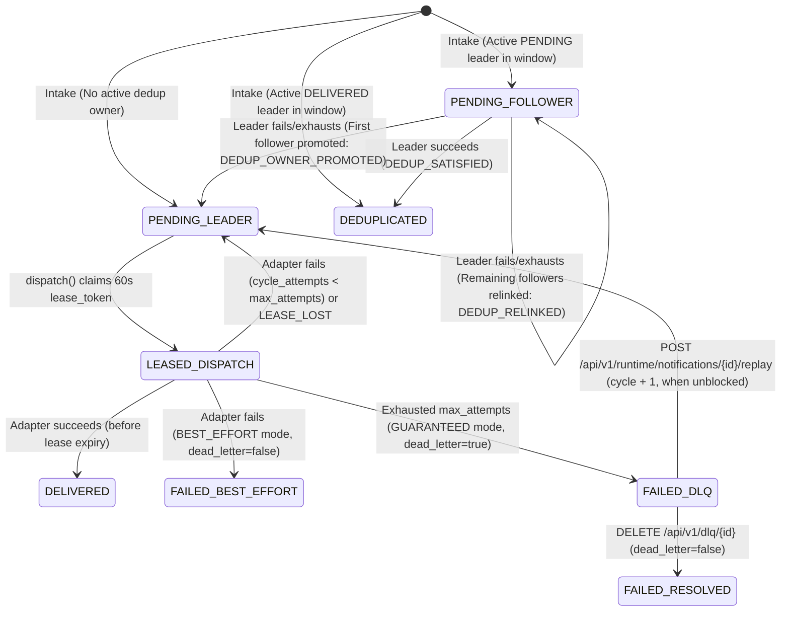
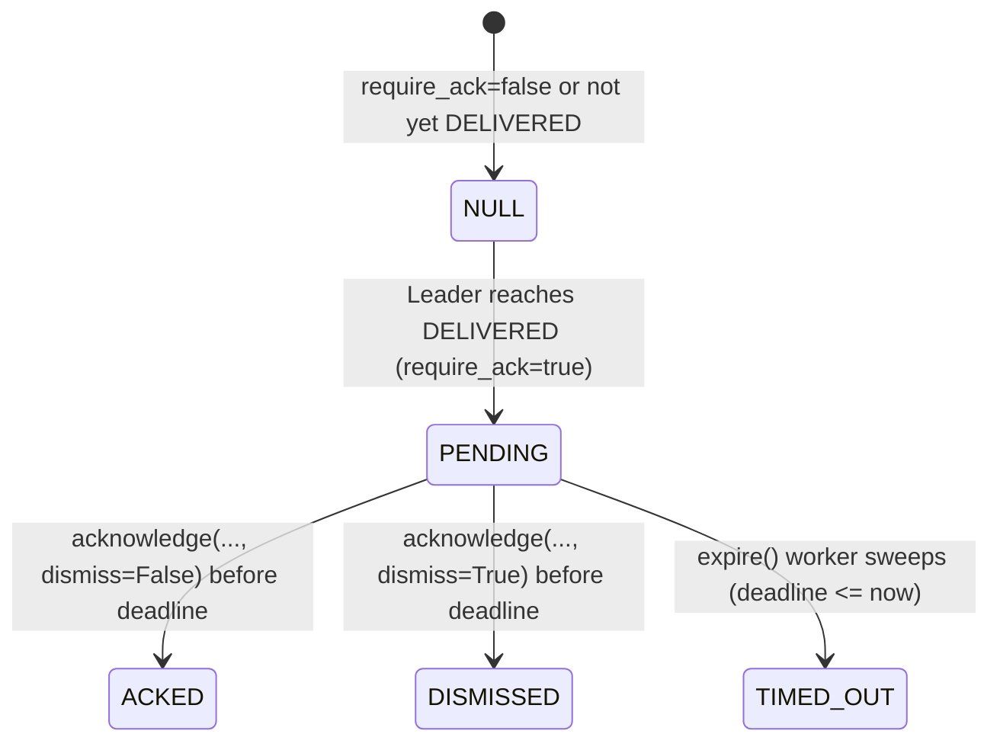

# Support Reference: State Machines, Database Schema, and Event Catalog

This reference provides support and on-call engineers with the authoritative state machines, relational database table schemas, and operational event catalog for `uns.Runtime` (`src/uns/runtime.py` and `src/db/models/`).

---

## 1. Notification Delivery & Deduplication State Machine

Every accepted notification row in `uns_notifications` tracks two orthogonal lifecycles:
1. **Delivery Status (`status`, `dead_letter`, `dedup_owner_id`, `dedup_generation`, `dedup_successor_id`)**
2. **Acknowledgment Status (`ack_status`, `deadline`, `actor`, `responded_at`)**

### 1.1 Delivery & Deduplication Lifecycle (`uns_notifications.status`)

| `status` | `dead_letter` | `dedup_owner_id` | Operational Meaning |
| :--- | :--- | :--- | :--- |
| `PENDING` | `false` | `NULL` | **Leader** obligation awaiting dispatch or backoff retry (`next_attempt <= now`, `lease_until <= now`). Pending ownership survives deduplication TTL expiry. |
| `PENDING` | `false` | `<owner_uuid>` | **Follower** obligation coalesced behind an in-flight `PENDING` leader of the same `(dedup_key, dedup_generation)`. |
| `DELIVERED` | `false` | `NULL` | Channel delivery succeeded and committed while holding a valid lease. |
| `DEDUPLICATED` | `false` | `<owner_uuid>` | Coalesced obligation satisfied by its leader's delivery within the same deduplication window/generation. |
| `FAILED` | `false` | `NULL` | Terminal failure for `BEST_EFFORT` delivery, or a `GUARANTEED` failure whose DLQ flag was cleared via `resolve_failure` (`DELETE /api/v1/dlq/{id}`). |
| `FAILED` | `true` | `NULL` | **Dead-Lettered (`DLQ`)** `GUARANTEED` obligation that exhausted `max_attempts` in its current `cycle`. Eligible for operator `replay` unless blocked by a pending/satisfied `dedup_successor_id`. |

### 1.2 Acknowledgment Lifecycle (`uns_notifications.ack_status`)

When a notification with `require_ack = true` transitions to `status = "DELIVERED"`, `uns.Runtime.dispatch` initializes `ack_status = "PENDING"` and sets `deadline = delivered_at + (60 * ack_timeout_minutes)`.

| `ack_status` | Terminal? | Enqueues Callback? | Operational Meaning |
| :--- | :--- | :--- | :--- |
| `NULL` | N/A | No | Notification does not require acknowledgment, or has not yet reached `DELIVERED`. |
| `PENDING` | No | No | Delivered and awaiting operator/agent response before `deadline`. |
| `ACKED` | **Yes** | **Yes** (if `Runtime.callback` set) | Acknowledged before `deadline` by `actor`. Same-actor retry is idempotent; different actor raises `409 Conflict`. |
| `DISMISSED` | **Yes** | **Yes** (if `Runtime.callback` set) | Dismissed before `deadline` by `actor`. |
| `TIMED_OUT` | **Yes** | **Yes** (if `Runtime.callback` set) | Swept by `Runtime.expire()` after `deadline <= now` (`actor = "uns-timeout-worker"`). Late human ACKs raise `409 Conflict`. |

---

## 2. Database Schema Reference

### 2.1 `uns_notifications` (Transactional Outbox & State Table)
Defined in `src/uns/runtime.py` (`work = Table("uns_notifications", ...)`).

| Column | Type | Nullable | Description |
| :--- | :--- | :--- | :--- |
| `id` | `String(36)` (PK) | No | Notification UUID string. |
| `key` | `String(64)` (Unique) | No | SHA-256 idempotency digest of `[principal, source, idempotency_key]`. |
| `fingerprint` | `String(64)` | No | SHA-256 digest of the canonical `SendNotificationRequest` JSON payload. |
| `principal` | `String(255)` | No | Authenticated producer principal that submitted the request. |
| `notification` | `JSON` | No | Full serialized `Notification` domain model (includes `metadata.uns_resolution`). |
| `status` | `String(32)` | No | `PENDING`, `DELIVERED`, `FAILED`, or `DEDUPLICATED`. |
| `outcome` | `JSON` | No | Serialized `NotificationResult` (`channels_attempted`, `channels_succeeded`, `channels_failed`, `error_message`). |
| `attempts` | `Integer` | No | Cumulative dispatch attempts across all replay cycles. |
| `cycle` | `Integer` | No | Delivery cycle number (starts at `1`; incremented on operator `replay`). |
| `cycle_attempts` | `Integer` | No | Dispatch attempts within the current `cycle` (compared against `max_attempts`). |
| `dedup_key` | `String(64)` | Yes | SHA-256 digest of `[principal, source, n.dedup_key, effective_hash]`. |
| `dedup_owner_id` | `String(36)` | Yes | `NULL` for leaders; UUID of the leader notification for followers. |
| `dedup_generation` | `Integer` | Yes | Deduplication generation counter scoped to `dedup_key`. |
| `dedup_successor_id` | `String(36)` (Indexed) | Yes | Durable successor notification UUID recorded when a failed leader hands off its obligation (`OBLIGATION_HANDED_OFF`). Guards `replay()` against duplicate satisfaction. |
| `next_attempt` | `Float` | No | Unix epoch timestamp (seconds) when the next dispatch attempt is eligible. |
| `lease_until` | `Float` | No | Unix epoch timestamp when the active worker lease expires (`0` when unleased). |
| `lease_token` | `String(36)` | Yes | Fencing token UUID held by the active worker during `dispatch()`. |
| `dead_letter` | `Boolean` | No | `True` when a `GUARANTEED` notification exhausts `max_attempts`. |
| `delivered_at` | `Float` | Yes | Unix epoch timestamp when `status` became `DELIVERED`. |
| `deadline` | `Float` | Yes | Unix epoch timestamp when `ack_status = "PENDING"` expires. |
| `ack_status` | `String(32)` | Yes | `PENDING`, `ACKED`, `DISMISSED`, or `TIMED_OUT`. |
| `actor` | `String(255)` | Yes | Principal that settled `ack_status` (or `"uns-timeout-worker"`). |
| `responded_at` | `Float` | Yes | Unix epoch timestamp when `ack_status` reached a terminal state. |
| `response_metadata` | `JSON` | Yes | Metadata dictionary supplied with `acknowledge`/`dismiss`. |

### 2.2 `uns_events` (Operational Timeline & Callback Outbox)
Defined in `src/uns/runtime.py` (`events = Table("uns_events", ...)`).

| Column | Type | Nullable | Description |
| :--- | :--- | :--- | :--- |
| `id` | `String(36)` (PK) | No | Event UUID string. |
| `notification_id` | `String(36)` (Indexed) | No | Target notification UUID (or self-UUID for `RETENTION_APPLIED` receipts). |
| `kind` | `String(50)` | No | Event type identifier (see Section 3 below). |
| `at` | `Float` | No | Unix epoch timestamp when the event was recorded (`Runtime.clock()`). |
| `payload` | `JSON` | No | Structured event details. |
| `callback_pending` | `Boolean` | No | `True` when `Runtime.callback` is configured and `kind` is `ACKED`, `DISMISSED`, or `TIMED_OUT` awaiting delivery. |
| `callback_until` | `Float` | No | Due/lease/backoff timestamp for `deliver_callbacks()` (initialized to event time `self.clock()`, indexed by `ix_uns_callbacks`). |
| `callback_token` | `String(36)` | Yes | Fencing token for the active callback worker. |
| `callback_attempts` | `Integer` | No | Number of callback delivery attempts (`0..3`). |
| `callback_error` | `String(2000)` | Yes | Last exception string if callback delivery failed. |

### 2.3 `uns_dedup` (Active Coalescing Windows)
Defined in `src/uns/runtime.py` (`dedup = Table("uns_dedup", ...)`).

| Column | Type | Nullable | Description |
| :--- | :--- | :--- | :--- |
| `key` | `String(64)` (PK) | No | Deduplication key digest (`[principal, source, n.dedup_key, effective_hash]`). |
| `until` | `Float` | No | Unix epoch timestamp when the delivered suppression window expires. Pending ownership remains live across `until` expiry. |
| `owner_id` | `String(36)` | Yes | Notification UUID of the current window leader. |
| `generation` | `Integer` | No | Monotonically increasing generation counter for this `key`. |

### 2.4 Compliance Audit & Policy Tables (`src/db/models/`)
- **`notification_audit_records`**: Append-only compliance delivery records (`id`, `notification_id`, `notification_type`, `status`, `channels_attempted`, `channels_succeeded`, `channels_failed`, `error_message`, `intent`, `delivery_mode`, `autonomy_mode`, `agent_id`, `policy_config_id`, `policy_config_hash`, `delivered_at`, `created_at`).
- **`ack_audit_records`**: Append-only acknowledgment transition records (`id`, `notification_id`, `old_status`, `new_status`, `acked_by`, `acked_at`, `ack_metadata`, `created_at`).
- **`notification_policy_revisions` / `notification_policy_snapshots` / `notification_policy_contents` / `notification_policies`**: Durable revision-locked policy authority managed by `SQLAlchemyPolicyStore` (`src/db/policy_store.py`).

---

## 3. Operational Event Catalog (`uns_events.kind`)

| Event `kind` | Emitted By | Key `payload` Fields | Operational Significance |
| :--- | :--- | :--- | :--- |
| `ACCEPTED` | `Runtime.accept` | `policy_id`, `policy_hash`, `revision`, `effective`, `effective_hash` | Obligation durably committed with its immutable policy snapshot. |
| `DEDUP_LINKED` | `Runtime.accept` | `owner_id`, `generation`, `owner_status` | Incoming notification coalesced behind an active `PENDING` or `DELIVERED` leader. |
| `ATTEMPT_STARTED` | `Runtime.dispatch` | `attempt`, `cycle`, `cycle_attempt`, `recovery_may_repeat_provider_effect` | Worker claimed a 60s lease and began a dispatch attempt. |
| `CHANNEL_ATTEMPT_STARTED` | `Runtime._before_attempt` | `channel`, `lease_token`, `attempt`, `cycle`, `cycle_attempt`, `provider_effect_may_have_occurred: true` | Lease verified immediately prior to invoking an external channel adapter. |
| `CHANNEL_ATTEMPT_RESULT` | `Runtime._channel_result` | `lease_token`, `attempt`, `cycle`, `cycle_attempt`, `channel`, `success`, `message_id`, `error`, `metadata`, `provider_observed_at` | Append-only per-channel provider observation attributed to the original `lease_token`. Survives even if the worker subsequently loses its lease (`LEASE_LOST`). |
| `LEASE_LOST` | `Runtime.dispatch` / `_record_lease_loss` | `lease_token`, `attempt`, `provider_effect_may_have_occurred: true` | Worker lease expired (`lease_until <= now`) before or after adapter execution; local aggregate settlement was aborted. |
| `DELIVERY_RESULT` | `Runtime.dispatch` | `status`, `attempt`, `cycle`, `cycle_attempt`, `dead_letter`, `outcome` | Worker committed the attempt outcome (`DELIVERED`, `PENDING`, or `FAILED`). |
| `OBLIGATION_HANDED_OFF` | `Runtime._settle_followers` | `successor_id`, `generation` | Recorded on an exhausted leader when it promotes a follower or hands off to a newer active owner (`dedup_successor_id`). |
| `DEDUP_SATISFIED` | `Runtime._settle_followers` | `previous_owner_id`, `owner_id`, `generation` | Pending follower transitioned to `DEDUPLICATED` because its leader succeeded. |
| `DEDUP_OWNER_PROMOTED` | `Runtime._settle_followers` | `previous_owner_id`, `owner_id`, `generation` | First pending follower promoted to leader (`dedup_owner_id = NULL`) after previous leader exhausted retries. |
| `DEDUP_RELINKED` | `Runtime._settle_followers` | `previous_owner_id`, `owner_id`, `generation` | Remaining pending followers relinked to the newly promoted successor leader. |
| `ACKED` | `Runtime._respond` | `actor`, `metadata` | Notification acknowledged before `deadline`. |
| `DISMISSED` | `Runtime._respond` | `actor`, `metadata` | Notification dismissed before `deadline`. |
| `TIMED_OUT` | `Runtime.expire` | `actor: "uns-timeout-worker"`, `metadata: {"escalation_required": true}` | Acknowledgment deadline elapsed without human/agent response. |
| `REPLAY_REQUESTED` | `Runtime.replay` | `actor`, `cycle`, `cumulative_attempts` | Operator initiated a new delivery cycle for an unblocked dead-lettered notification. |
| `FAILURE_RESOLVED` | `Runtime.resolve_failure` | `actor` | Operator cleared `dead_letter = false` via `DELETE /api/v1/dlq/{id}` without replaying. |
| `RETENTION_APPLIED` | `uns.maintenance.maintain` | `operator`, `cutoff`, `deleted_rows`, `notification_ids`, `dedup_keys`, `archive` or `removed` | Durable receipt of an `uns-maintain --apply` execution. Never pruned. |

---

## Related Documentation

- [Troubleshooting Guides Index](../tsg/README.md)
- [API Reference](../API.md)
- [Deployment Guide](../DEPLOYMENT.md)
- [Observability](../sections/observability.md)
